# Arquitetura — Plataforma Descentralizada de Coordenação de Eventos Comunitários

> Status: linha de base do design. Este é o documento de design de origem. Os
> detalhes normativos de wire/protocolo ficam em [`protocol.md`](protocol.md); quando os
> dois divergirem, `protocol.md` prevalece e este documento deve ser atualizado.

## 1. Resumo Executivo

Este projeto é uma plataforma local-first e que preserva a privacidade, para organizar eventos comunitários e coordenar as pessoas que podem participar deles.

O caso de uso principal é a organização política/comunitária, em que as comunidades precisam:

- criar e gerenciar eventos;
- recrutar e alocar pessoas para eventos;
- convidar pessoas específicas;
- permitir que membros se voluntariem;
- cruzar eventos com a disponibilidade e a localização aproximada de uma pessoa;
- integrar com os calendários da Apple, do Google e da Microsoft;
- continuar funcionando quando usuários ou a infraestrutura estiverem offline;
- evitar centralizar os calendários, a disponibilidade e as localizações precisas dos usuários;
- minimizar custos de infraestrutura e de operação;
- evitar dependência de fornecedor (vendor lock-in);
- permitir que as comunidades auto-hospedem sua infraestrutura.

O princípio arquitetural central é:

> **O dispositivo do usuário é dono dos dados pessoais. A comunidade é dona do estado organizacional compartilhado. Um nó da comunidade fornece persistência e sincronização, mas não precisa ser confiável para guardar dados privados em texto claro.**

O sistema deve ser local-first, eventualmente consistente, criptografado de ponta a ponta para dados sensíveis da comunidade e portável entre provedores de infraestrutura.

## 2. Objetivos

### 2.1 Objetivos Principais

1. Custo de operação muito baixo
2. Nenhum banco de dados centralizado obrigatório
3. Infraestrutura independente de fornecedor
4. Operação local-first
5. Suporte offline
6. Privacidade forte
7. UX simples para usuários não técnicos
8. Experiência mobile nativa
9. Integração com calendários
10. Moderação da comunidade e controle de membros
11. Nós da comunidade auto-hospedados
12. Hospedagem gerenciada opcional
13. Recuperabilidade caso um nó desapareça
14. Escalabilidade para grandes números de usuários e comunidades

### 2.2 Fora do Escopo da Versão Inicial

Não tentar fornecer inicialmente:

- anonimato perfeito;
- rede livre de metadados;
- privacidade no estilo Tor/mixnet;
- consenso em blockchain;
- identidade descentralizada global;
- descoberta de pares totalmente autônoma;
- bancos de dados distribuídos multirregião complexos;
- colaboração em tempo real comparável ao Google Docs.

O sistema inicial deve resolver o problema organizacional real antes de resolver todo problema teórico de sistemas distribuídos.

## 3. Princípios Arquiteturais Centrais

### 3.1 Local-First

As informações pessoais devem permanecer no dispositivo do usuário sempre que possível.

A plataforma não deve precisar receber:

- o calendário completo do usuário;
- os títulos de eventos do calendário pessoal;
- o histórico detalhado de disponibilidade;
- o histórico preciso de GPS;
- compromissos não relacionados;
- o histórico de localização pessoal.

Em vez disso, o dispositivo avalia localmente se o usuário pode participar de um evento.

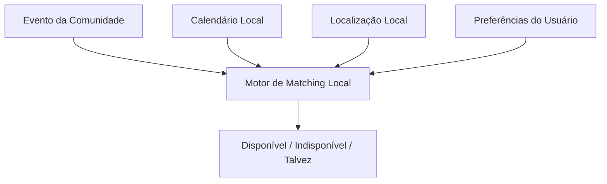

### 3.2 O Servidor Não É o Dono dos Dados

O nó da comunidade é um mecanismo de sincronização e persistência. Ele não deve ser tratado como o dono autoritativo de cada informação.

A arquitetura deve tornar possível destruir um nó e reconstruí-lo a partir de dispositivos autorizados.

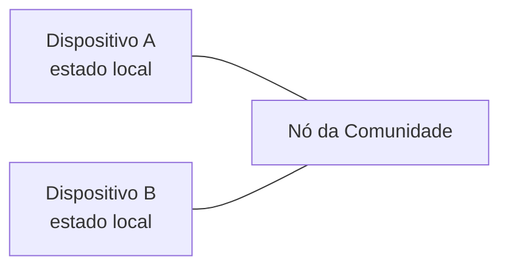

O nó é útil porque dispositivos móveis ficam offline com frequência, mas a comunidade não deve se tornar permanentemente dependente de um único servidor.

### 3.3 Identidade Criptográfica

Usuários e comunidades devem ter identidades criptográficas independentes da infraestrutura.

Uma comunidade é identificada por sua identidade criptográfica, e não por `https://community.example.com`. Em vez disso, conceitualmente:

```
Community ID = hash(community public identity key)
```

O endereço de um nó é apenas um lugar onde a comunidade pode ser alcançada no momento. Isso permite:

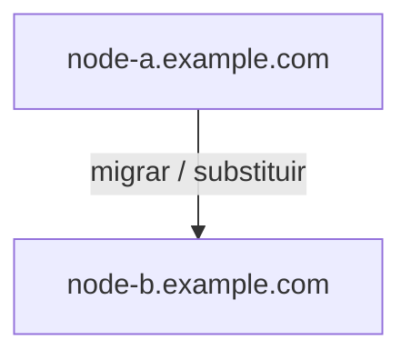

sem alterar a identidade da comunidade.

## 4. Arquitetura de Alto Nível

A arquitetura inicial contém dois componentes principais.

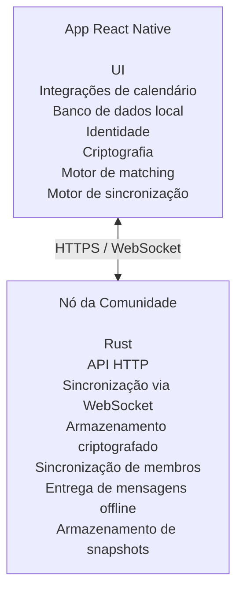

Mais adiante, vários nós podem replicar a mesma comunidade:

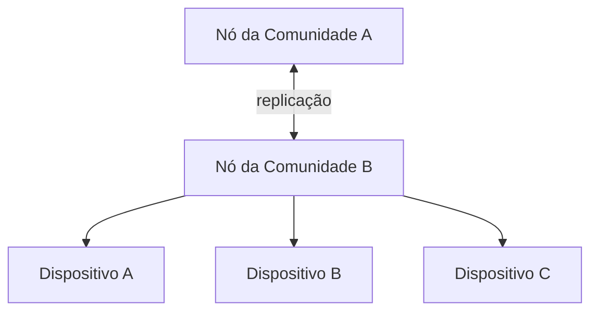

A replicação multinó não é necessária para o primeiro MVP.

## 5. Aplicativo Mobile

### 5.1 Tecnologia Recomendada

- React Native;
- TypeScript;
- SQLite;
- APIs nativas de calendário;
- Google Calendar API;
- Microsoft Graph;
- uma biblioteca criptográfica dedicada;
- uma camada compartilhada de domínio/protocolo em TypeScript.

O aplicativo mobile contém a maior parte da lógica de negócio.

```
apps/
    mobile/
packages/
    domain/
    protocol/
    crypto/
    sync/
```

O código específico de plataforma fica isolado em `apps/mobile/ios/` e `apps/mobile/android/`. Isso dá ao projeto um caminho para um futuro cliente web sem acoplar o protocolo ao React Native.

## 6. Por Que React Native em Vez de uma PWA

Uma PWA é tecnicamente capaz de implementar boa parte da arquitetura. No entanto, a UX é um requisito crítico para este projeto. Os usuários-alvo podem:

- ter conhecimento técnico limitado;
- não se sentir à vontade com fluxos de autorização;
- não estar familiarizados com sistemas descentralizados;
- ter celulares mais antigos;
- precisar de notificações confiáveis;
- precisar de explicações muito claras sobre o que o aplicativo está fazendo.

Portanto, o cliente de produção deve priorizar recursos mobile nativos. O React Native oferece:

- notificações push nativas;
- acesso confiável às APIs da plataforma;
- integrações nativas de calendário;
- melhor controle sobre o comportamento do ciclo de vida;
- uma experiência familiar de app mobile;
- um caminho para iOS e Android a partir de uma única base de código.

Ainda assim, o protocolo descentralizado deve permanecer independente do React Native.

## 7. Identidade do Usuário

Cada instalação do aplicativo cria uma identidade criptográfica (par de chaves de assinatura pública/privada).

A chave privada deve:

- permanecer no dispositivo do usuário;
- nunca ser enviada ao nó da comunidade;
- nunca ser exigida pelo servidor;
- ser protegida pelo armazenamento seguro da plataforma sempre que possível.

A chave pública pode ser compartilhada com as comunidades.

## 8. Chaves Separadas de Assinatura e Criptografia

Não use uma única chave para todos os propósitos criptográficos. No mínimo, distinga entre uma **identidade de assinatura** e uma **identidade de criptografia**.

- A assinatura responde: *"Este usuário realmente autorizou esta operação?"*
- A criptografia responde: *"Quem tem permissão para ler este conteúdo?"*

Essa separação torna a rotação de chaves e o gerenciamento de membros consideravelmente mais fáceis.

## 9. Identidade da Comunidade

Uma comunidade também tem uma identidade criptográfica: `community_id`, uma chave pública de identidade da comunidade e material de chave administrativa privada da comunidade.

O material de chave administrativa privada não deve simplesmente ficar em texto claro no nó da comunidade. Inicialmente, um único administrador pode controlá-lo. O protocolo deve, em algum momento, suportar vários administradores e autorização por limiar (threshold; por exemplo, 2 de 3 administradores) para operações particularmente sensíveis.

## 10. Membros

```
Member {
    user_id
    public_key
    role
    status
    joined_at
    key_epoch
}
```

Papéis possíveis: `member`, `organizer`, `admin`.

Não confie isoladamente em um campo de papel do lado do servidor. Mudanças de papel devem ser representadas como operações assinadas:

```
GrantRole {
    community_id
    user_id
    role: admin
    author
    version
    signature
}
```

Os clientes podem então verificar de forma independente que a operação foi autorizada.

## 11. Entrando em uma Comunidade

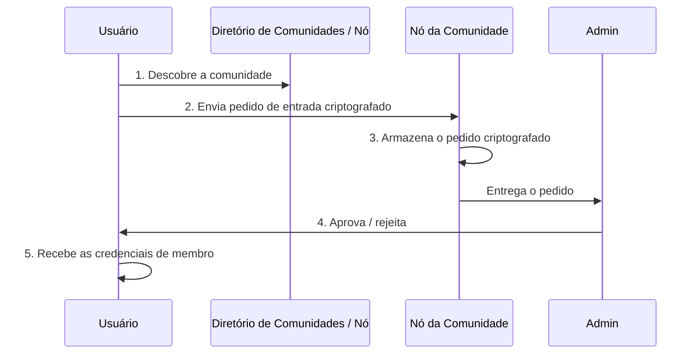

O nó não precisa entender o conteúdo do pedido.

## 12. Criptografando Pedidos de Entrada

Um pedido de entrada pode conter informações sensíveis fornecidas pelo solicitante. O solicitante criptografa o pedido antes de enviá-lo, usando um padrão de criptografia híbrida.

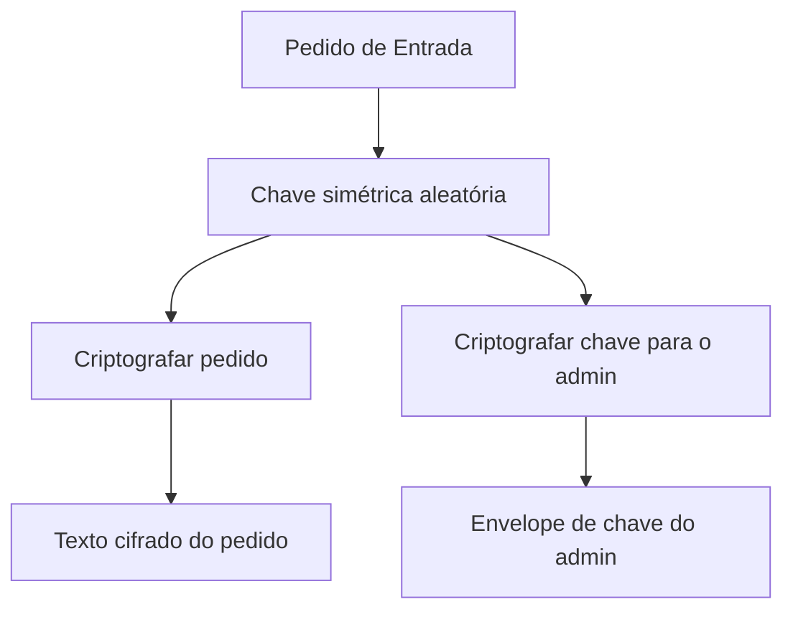

O nó simplesmente armazena o texto cifrado e o entrega aos administradores autorizados. O nó não tem a chave de descriptografia.

## 13. Chave de Criptografia da Comunidade

O conteúdo compartilhado da comunidade é protegido por uma chave simétrica baseada em épocas (por exemplo, época 17, chave `K17`). Cada membro recebe um envelope criptografado contendo a chave atual da comunidade:

```
Encrypt(K17, MemberA Public Key)
Encrypt(K17, MemberB Public Key)
Encrypt(K17, MemberC Public Key)
```

O nó da comunidade pode armazenar esses envelopes criptografados. Ele não precisa ter acesso a `K17`.

## 14. Rotação de Chaves

Mudanças nos membros exigem rotação de chaves.

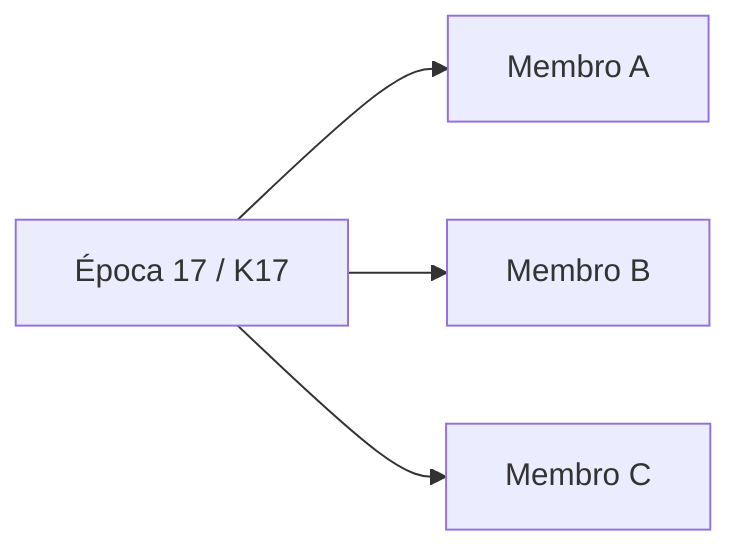

C sai. Gere a época 18 / `K18` e distribua apenas aos membros restantes:

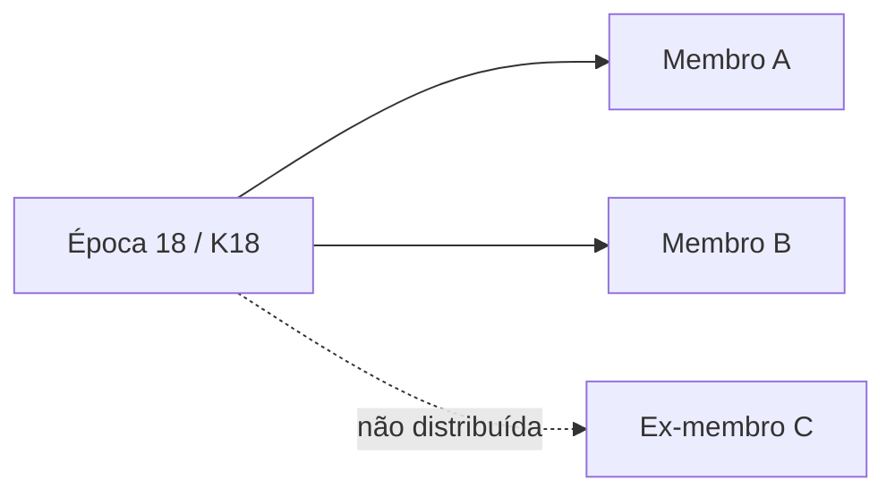

C pode continuar descriptografando dados criptografados com `K17`, pois já possuía essa chave legitimamente. C não consegue descriptografar novos dados criptografados com `K18`.

O nó não inicia a rotação. Um dispositivo autorizado é quem inicia.

## 15. Membros Offline Durante a Rotação de Chaves

A rotação de chaves não deve exigir que todos os membros estejam online. Com 100 membros, 1 saindo, 50 online e 49 offline, a nova chave é criptografada para os 99 membros restantes. Para os membros offline, o nó armazena seus envelopes de chave criptografados. Quando um membro se reconecta:

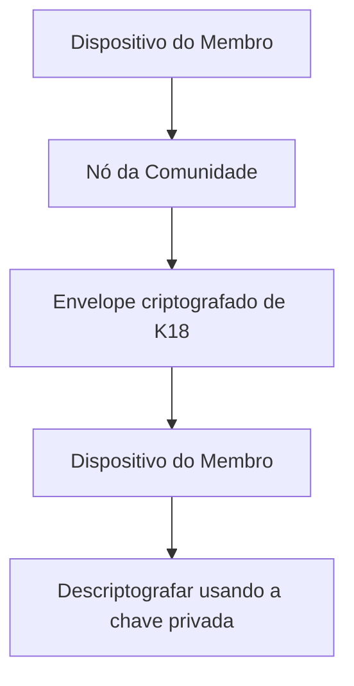

O nó nunca precisa conhecer `K18`.

## 16. Modelo de Evento

```
Event {
    id
    title
    description
    starts_at
    ends_at
    location
    capacity
    status
    organizer_id
    created_at
}
```

Dependendo dos requisitos de privacidade, alguns campos podem ser públicos dentro da comunidade, enquanto outros permanecem criptografados.

## 17. Modelo de Localização

O histórico preciso de GPS nunca deve ser exigido. O usuário escolhe uma localização de referência (Casa, Trabalho, Recife, Olinda, uma localização personalizada ou um ponto no mapa). O app armazena `preferred_location` e `preferred_radius` localmente. O usuário pode mudar o ponto de referência manualmente — por exemplo, *"Estou em Recife agora, mas me mostre eventos perto de São Paulo porque vou viajar para lá semana que vem."* — sem revelar sua localização GPS atual.

## 18. Integrações de Calendário

- **Apple Calendar** — EventKit nativo. Os dados do calendário ficam no dispositivo.
- **Google Calendar** — OAuth 2 com PKCE; o app conversa diretamente com as APIs do Google. Nenhum client secret no app.
- **Microsoft Outlook / Calendar** — Microsoft Graph com OAuth e PKCE. Os dados do calendário são processados localmente.

## 19. Matching de Calendário

O dispositivo compara um evento (data, horário, local) com o calendário local, a localização preferida local, as restrições de deslocamento e as preferências do usuário, e produz `Available`, `Unavailable` ou `Maybe`. O calendário pessoal completo nunca é transmitido.

## 20. Fluxo de Voluntariado

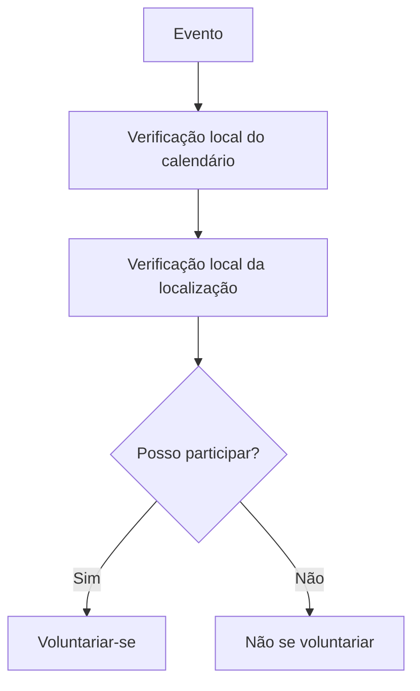

A comunidade recebe apenas o pedido de participação necessário.

## 21. Fluxo de Convite

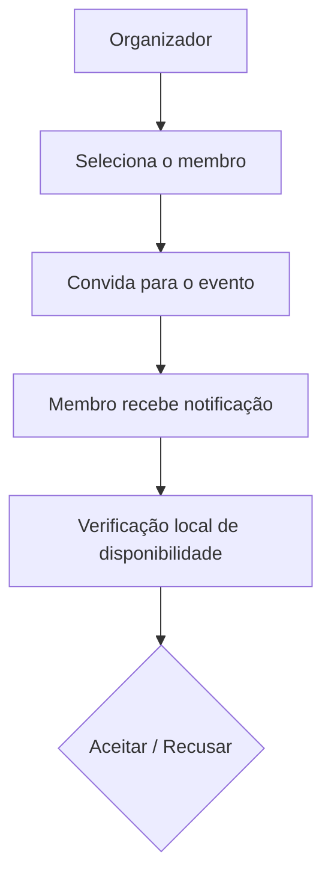

O sistema não deve alocar pessoas a eventos silenciosamente. A pessoa deve aceitar explicitamente.

## 22. Encontrando Pessoas Adequadas

Uma comunidade pode querer *"encontrar pessoas que poderiam razoavelmente participar deste evento."* O matching roda nos dispositivos dos membros, e o sistema expõe apenas um sinal mínimo de elegibilidade (`eligible: true`) em vez de detalhes do calendário. A informação exata exposta aos organizadores é uma decisão deliberada de privacidade.

## 23. Descoberta de Comunidades

Um pequeno diretório público contém:

```
CommunityDirectoryEntry {
    community_id
    name
    description
    approximate_region
    public_key
    join_policy
    node_addresses
}
```

Ele não deve conter listas de membros, localizações de membros, disponibilidade, calendários nem detalhes de eventos privados.

## 24. Nó da Comunidade

Um pequeno executável em Rust:

```
community-node
    ├── HTTP API
    ├── WebSocket sync
    ├── authentication
    ├── authorization
    ├── encrypted storage
    ├── delivery queue
    ├── snapshot storage
    └── sync protocol
```

Evite microsserviços, Kubernetes, Kafka, Redis e a exigência de PostgreSQL. A primeira implementação é **binário Rust + banco de dados SQLite**.

## 25. Por Que SQLite

SQLite não é o mesmo que centralizar a aplicação; é a persistência local do nó. O nó inteiro é `community-node` + `community.sqlite` + `config.toml`, e roda em uma VPS, Raspberry Pi, servidor doméstico, NAS, computador antigo ou qualquer VM na nuvem.

## 26. Armazenamento do Nó

Conceitualmente: `communities`, `members`, `operations`, `snapshots`, `key_envelopes`, `delivery_queue`. A maior parte do conteúdo sensível é criptografada antes de chegar ao nó.

## 27. O Nó como Caixa Postal

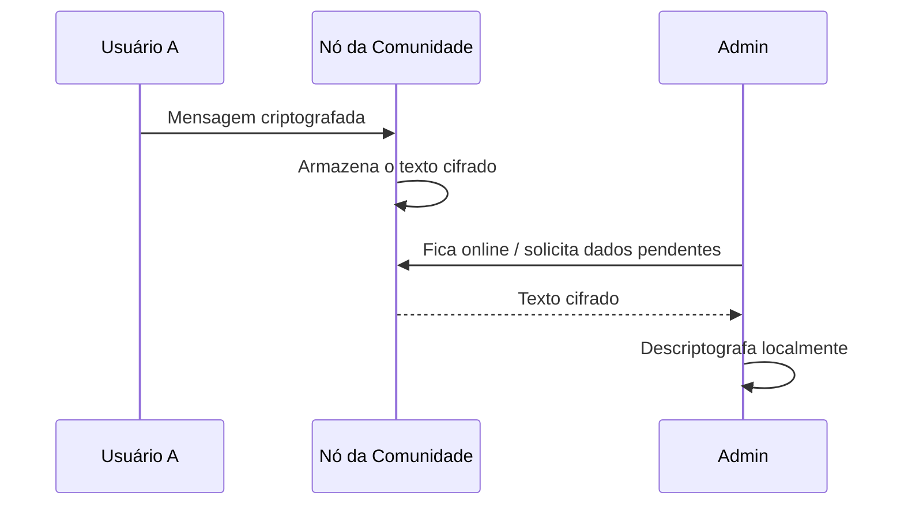

Este é o mecanismo-chave que permite que usuários offline se comuniquem sem exigir que o destinatário esteja online.

## 28. Entrega Offline

Se o membro e o admin estiverem offline, mas o nó estiver online, um novo pedido de entrada é armazenado como texto cifrado e entregue quando o admin ficar online. Nenhuma chave privada precisa existir no nó.

## 29. Comprometimento do Nó

Um atacante que obtenha o banco de dados inteiro do nó deve obter principalmente textos cifrados, chaves públicas, assinaturas e metadados de protocolo — **não** o conteúdo de calendários, a disponibilidade pessoal, o conteúdo privado da comunidade, mensagens privadas ou as chaves de criptografia da comunidade. Este é um requisito central de segurança.

## 30. Protocolo de Sincronização

A sincronização é baseada em versões. Cada comunidade tem uma versão lógica monotonicamente crescente. Um dispositivo diz *"Tenho a versão 183"*; o nó responde com a versão atual e as atualizações posteriores à 183.

## 31. Operações

```
Operation {
    operation_id
    community_id
    version
    type
    timestamp
    author
    payload
    signature
}
```

O payload pode ser criptografado. A assinatura permite que os clientes verifiquem quem autorizou a operação.

## 32. Idempotência

Toda operação tem um `operation_id` globalmente único. Receber a mesma operação duas vezes a aplica uma única vez. Isso é essencial porque a retransmissão em redes móveis é normal.

## 33. Sincronização Retomável

Se um dispositivo se desconectar após a versão 190, ele pede as operações posteriores à 190 — não reinicia a sincronização.

## 34. Snapshots


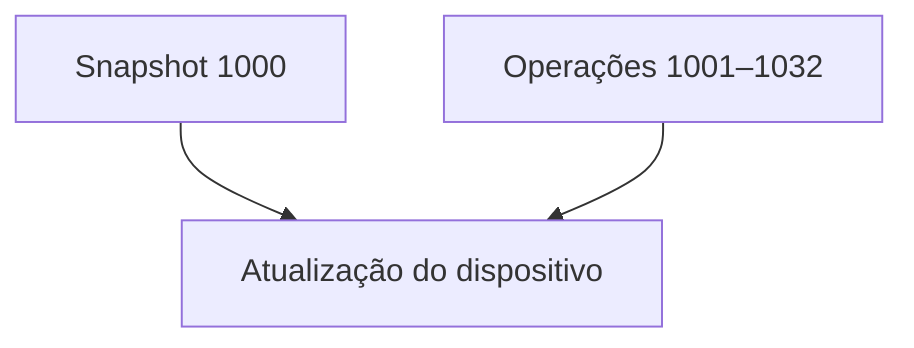

Um dispositivo que ficou offline baixa o snapshot e apenas as operações posteriores a ele.

## 35. Compactação de Eventos

Um evento pode gerar muitas operações (criação, voluntários, cancelamentos, convites, aceites, conclusão, presença). Após a conclusão, o estado útil pode ser simplesmente:

```
EventSummary {
    id
    title
    date
    status: completed
    attendance_count
}
```

ou, se a presença individual for necessária, `attendees: [A, C, D]`. As operações intermediárias não precisam permanecer para sempre.

## 36. Política de Retenção

| Classe | Exemplos | Retenção |
|---|---|---|
| Efêmera | mensagens transitórias, metadados temporários de sincronização, sondagens de disponibilidade | horas / dias |
| Operacional | eventos ativos, vínculos de membros atuais, convites e pedidos de entrada pendentes | até não serem mais necessários |
| Histórica | resumos de eventos concluídos, estatísticas de presença | meses / anos, conforme a política da comunidade |

## 37. Semântica do Snapshot

```
CommunitySnapshot {
    version
    community { id, metadata, key_epoch }
    members { ... }
    active_events { ... }
    completed_event_summaries { ... }
    pending_invitations { ... }
    pending_membership_requests { ... }
}
```

Um snapshot nunca contém calendários pessoais, histórico de GPS ou informações pessoais não relacionadas.

## 38. Dispositivos Offline por Meses

Um dispositivo offline por 90 dias recebe o snapshot mais recente mais as atualizações posteriores a ele. Se operações antigas tiverem sido compactadas, ele recebe um snapshot mais novo.

## 39. Falha do Nó

O nó não é a única cópia do estado da comunidade:

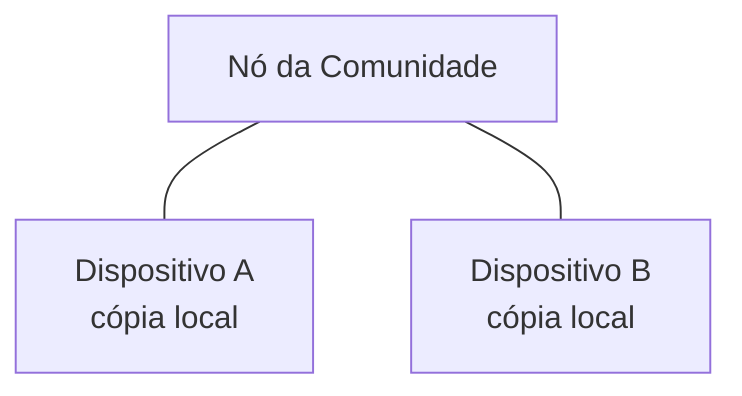

Se o nó desaparecer, dispositivos autorizados provisionam um novo nó e o repovoam.

## 40. Nós Auto-Hospedados

```
community-node --community <community-id>
```

Roda em um computador doméstico, Raspberry Pi, NAS, VPS ou VM na nuvem. Software aberto e independente de provedor.

## 41. Nós Gerenciados

> **A hospedagem gerenciada deve usar exatamente o mesmo software de nó que a auto-hospedagem.**

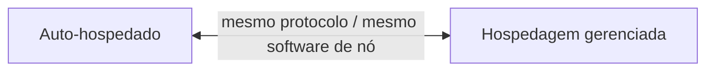

Uma comunidade pode migrar entre os dois.

> Implementado na Fase 10: tenants, cotas e uma API de operador no mesmo
> binário, e uma operação de controle `migrate` assinada que congela o nó antigo e
> que os dispositivos dos membros verificam e seguem. Veja
> [`managed-hosting.md`](managed-hosting.md) e o §11.3 do protocolo.

## 42. Modelo de Custo

O nó executa principalmente: armazenar, recuperar, rotear, sincronizar, verificar. Os dispositivos executam: matching de calendário, matching de localização, computação sensível à privacidade, criptografia/descriptografia, reconstrução de estado. Adicionar usuários não aumenta proporcionalmente a computação do lado do servidor.

## 43. P2P / WebRTC

WebRTC pode ser adicionado mais tarde para reduzir o tráfego do nó, mas não deve ser necessário para a corretude. O fallback confiável continua sendo dispositivo → nó → dispositivo, evitando dependência de travessia de NAT, pares sempre online, execução em segundo plano no mobile e comportamento de firewalls.

## 44. Resolução de Conflitos

Operações podem chegar em ordens diferentes (por exemplo, aceitar no dispositivo A, recusar no dispositivo B). O protocolo define regras de domínio determinísticas — por exemplo, uma vez atingido um estado terminal, `accepted → declined` pode ser inválido. A resolução de conflitos é definida no nível do domínio, em vez de depender apenas de timestamps.

## 45. Consistência Eventual

Os dispositivos podem discordar temporariamente. Após a sincronização, eles convergem, desde que ambos possuam os dados autorizados necessários.

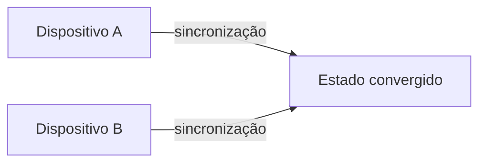

## 46. Verificação Criptográfica

Os clientes verificam de forma independente as operações críticas: quem criou um evento, aprovou um membro, concedeu admin, removeu um membro, alterou a política da comunidade. As operações carregam autor, assinatura, operation_id e versão lógica.

## 47. Modelo de Ameaças de Segurança

1. nó da comunidade comprometido;
2. administrador malicioso;
3. banco de dados do nó roubado;
4. interceptação de rede;
5. conta de usuário comprometida;
6. celular roubado;
7. membro removido;
8. nó destruído;
9. nó substituído;
10. operação reproduzida (replay);
11. operação duplicada;
12. dispositivos offline por muito tempo.

Veja [`threat-model.md`](threat-model.md).

## 48. Segurança do Transporte

O TLS protege os dados em trânsito; a criptografia no nível da aplicação protege os dados se o banco de dados do nó for comprometido. Ambos são necessários.

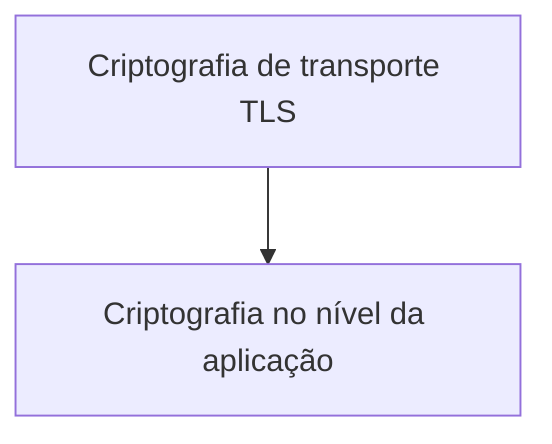

## 49. Privacidade de Metadados

A criptografia não esconde metadados: um nó pode descobrir que um usuário se conectou, que uma comunidade recebeu uma atualização ou que uma mensagem de ~N bytes foi armazenada. A primeira versão não tenta oferecer privacidade perfeita de metadados. O objetivo inicial:

> O nó não consegue reconstruir os calendários pessoais dos usuários, a disponibilidade detalhada ou o conteúdo criptografado da comunidade apenas a partir dos dados que armazena.

## 50. Notificações

As notificações push contêm o mínimo de informação. Evite *"Você foi convidado para um evento político em [endereço exato] às 19:00."* Prefira *"Você tem uma nova atividade."* O app abre e então busca e descriptografa o conteúdo.

## 51. Estrutura do Repositório

```
project/
├── apps/
│   ├── mobile/
│   └── node/
├── packages/
│   ├── domain/
│   ├── protocol/
│   ├── crypto/
│   └── sync/
├── crates/
│   ├── crypto/
│   ├── protocol/
│   └── storage/
├── docs/
│   ├── architecture.md
│   ├── protocol.md
│   ├── security.md
│   └── threat-model.md
└── tests/
    ├── protocol/
    ├── crypto/
    ├── sync/
    └── integration/
```

O protocolo é especificado de forma independente da implementação.

## 52. Plano de Implementação

**Fase 0 — Especificação do Protocolo.** Antes de qualquer UI, definir identidades, chaves, assinaturas, IDs de comunidade, membros, papéis, eventos, convites, participação, operações, snapshots, épocas de chave, sincronização, resolução de conflitos, retenção e descoberta de nós. Entregável: `docs/protocol.md`. Não comece pelo servidor.

**Fase 1 — Motor de Domínio Local.** Toda a máquina de estados da comunidade, localmente, sem rede: criar comunidade, adicionar/remover membro, criar evento, convidar, aceitar, recusar, voluntariar-se, concluir, presença, geração/restauração de snapshot, compactação de operações.

**Fase 2 — Camada Criptográfica.** Geração de identidade, assinaturas, criptografia, envelopes de chave, épocas, rotação de chaves por mudança de membros, snapshots e operações criptografados. Testes de segurança antes de seguir adiante.

**Fase 3 — Nó em Rust.** Rust + SQLite + HTTP + WebSocket. Autenticar dispositivos, armazenar/recuperar dados criptografados, manter versões, entregar mensagens pendentes, armazenar snapshots, fornecer informações de descoberta. Nenhuma inteligência de aplicação no nó.

**Fase 4 — Sincronização.** `sync(since_version)` com retomada, IDs de operação, deduplicação, assinaturas, rastreamento de versões, confirmações (acks), snapshots. Teste: dispositivo A offline, dispositivo B executa 1,000 operações, dispositivo A se reconecta.

**Fase 5 — Aplicativo Mobile.** Construído em torno do motor de domínio local. UX em primeiro lugar. Os usuários nunca veem "CRDT", "época", "nó", "chave pública", "envelope criptografado" ou "log de operações" — eles veem *Criar comunidade, Entrar na comunidade, Criar evento, Voluntariar-se, Convidar, Aceitar, Recusar*.

**Fase 6 — Integrações de Calendário.** Apple EventKit, depois Google Calendar, depois Microsoft Graph. Somente leitura, com disponibilidade calculada localmente.

**Fase 7 — Matching de Localização.** Localização preferida, atual e selecionada manualmente; raio; distância/tempo de deslocamento aproximados. Nunca exigir o compartilhamento de localização precisa.

**Fase 8 — Testes Offline no Mundo Real.** Usuário offline por 24 h / 7 d / 30 d; nó offline, destruído, substituído; admin offline; todos os admins offline; operações conflitantes; conexões instáveis. Mais importante do que benchmarks de desempenho nesta etapa.

**Fase 9 — Implantação do Nó da Comunidade.** Um binário que roda em qualquer lugar; imagem Docker + binário standalone, Docker opcional; configuração mínima.

**Fase 10 — Hospedagem Gerenciada.** Somente depois que a auto-hospedagem funcionar. O protocolo não deve depender de AWS, GCP, Azure, Cloudflare, Supabase ou Firebase.

## 53. Estratégia de Testes

- **Testes unitários** — transições de estado, operações criptográficas, serialização, snapshots, rotação de chaves, permissões.
- **Testes de propriedade** — operações aleatórias entregues em ordem aleatória, duplicadas, atrasadas, parcialmente ausentes; o estado válido resultante deve ser determinístico.
- **Testes de integração** — dispositivos A, B, C mais um nó, com falhas de rede simuladas.
- **Testes de segurança** — nó comprometido ⇒ conteúdo protegido ilegível; membro removido ⇒ nova época ⇒ ex-membro não consegue descriptografar dados novos.

## 54. Escopo do Primeiro MVP

- **Usuários** — identidade, perfil, vínculo com comunidades.
- **Comunidades** — criar, descobrir, pedir para entrar, aprovar, rejeitar, remover membro.
- **Eventos** — criar, editar, cancelar, voluntariar-se, convidar, aceitar, recusar, concluir.
- **Privacidade** — estado da comunidade criptografado, matching local de calendário, matching local de localização.
- **Infraestrutura** — um nó em Rust, SQLite, sincronização offline, snapshots.
- **Plataformas** — iOS, Android.

## 55. Funcionalidades a Adiar

WebRTC, consenso multinó, assinaturas por limiar (threshold), credenciais anônimas avançadas, diretórios públicos complexos, descoberta distribuída sofisticada, funções serverless, Kubernetes, blockchain.

## 56. Decisões Arquiteturais Mais Importantes

> **O nó da comunidade armazena estado criptografado suficiente para permitir que usuários offline sincronizem, mas não se torna o dono autoritativo dos dados privados dos usuários.**

> **O log de operações é um mecanismo de sincronização; o snapshot é a representação durável do estado significativo.**

O sistema retém histórico apenas quando esse histórico é de fato útil.

## 57. Arquitetura Final

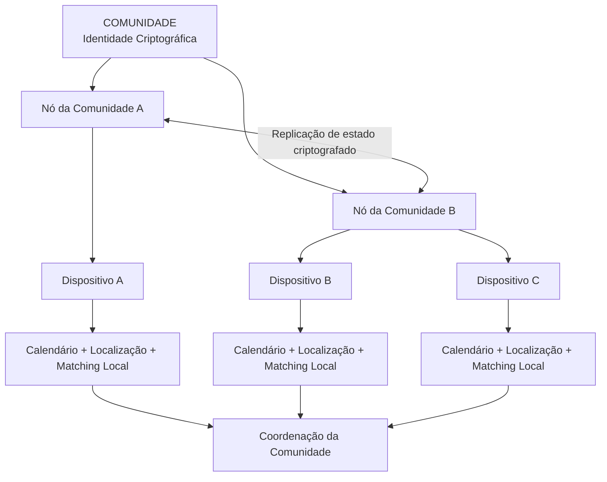

```mermaid
flowchart TD
    subgraph P[Dados privados ficam no dispositivo do usuário]
        C[Calendário] --> D[Dispositivo do Usuário]
        L[Localização] --> D
        R[Preferências] --> D
        D --> A[Disponibilidade / matching local]
        D --> E[Criptografia local]
    end
    E -->|Dados mínimos e criptografados da comunidade| N[Nó da Comunidade]
    N -->|Estado criptografado| O[Outros dispositivos]
```

## 58. Conclusão

O sistema não é serverless no sentido tradicional de nuvem. Ele é:

> **local-first + federado + auto-hospedável + criptografado + eventualmente consistente.**

Uma comunidade pode rodar *binário Rust + SQLite* em uma pequena VPS, em um Raspberry Pi ou no computador sempre ligado de um administrador, enquanto um provedor gerenciado oferece o mesmo nó como serviço pago. O provedor de infraestrutura é substituível; a identidade da comunidade, as identidades dos usuários, o estado criptografado, o protocolo e o aplicativo permanecem independentes da máquina que executa o nó.
