# Architecture — Decentralized Community Event Coordination Platform

> Status: design baseline. This is the source design document. The normative
> wire/protocol details live in [`protocol.md`](protocol.md); where the two
> disagree, `protocol.md` wins and this document should be updated.

## 1. Executive Summary

This project is a privacy-preserving, local-first platform for organizing community events and coordinating people who can attend them.

The primary use case is political/community organizing, where communities need to:

- create and manage events;
- recruit and assign people to events;
- invite specific people;
- allow members to volunteer;
- match events against a person's availability and approximate location;
- integrate with Apple, Google, and Microsoft calendars;
- continue operating when users or infrastructure are offline;
- avoid centralizing users' calendars, availability, and precise locations;
- minimize infrastructure and operational costs;
- avoid vendor lock-in;
- allow communities to self-host their infrastructure.

The core architectural principle is:

> **The user's device owns personal data. The community owns shared organizational state. A community node provides persistence and synchronization, but does not need to be trusted with plaintext private data.**

The system should be local-first, eventually consistent, encrypted end-to-end for sensitive community data, and portable across infrastructure providers.

## 2. Goals

### 2.1 Primary Goals

1. Very low operating cost
2. No mandatory centralized database
3. Vendor-independent infrastructure
4. Local-first operation
5. Offline support
6. Strong privacy
7. Simple UX for non-technical users
8. Native mobile experience
9. Calendar integration
10. Community moderation and membership control
11. Self-hosted community nodes
12. Optional managed hosting
13. Recoverability if a node disappears
14. Scalability to large numbers of users and communities

### 2.2 Non-Goals for the Initial Version

Do not initially attempt to provide:

- perfect anonymity;
- metadata-free networking;
- Tor/mixnet-style privacy;
- blockchain consensus;
- global decentralized identity;
- fully autonomous peer discovery;
- complex multi-region distributed databases;
- real-time collaboration comparable to Google Docs.

The initial system should solve the actual organizational problem before solving every theoretical distributed-systems problem.

## 3. Core Architectural Principles

### 3.1 Local-First

Personal information should remain on the user's device whenever possible.

The platform should not need to receive:

- the user's complete calendar;
- personal calendar event titles;
- detailed availability history;
- precise GPS history;
- unrelated appointments;
- personal location history.

Instead, the device locally evaluates whether the user can participate in an event.

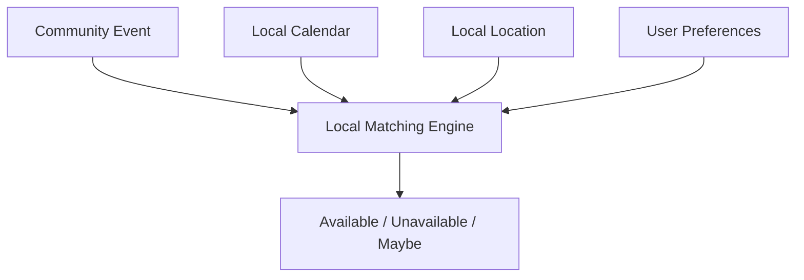

### 3.2 The Server Is Not the Owner of the Data

The community node is a synchronization and persistence mechanism. It should not be treated as the authoritative owner of every piece of information.

The architecture should make it possible to destroy a node and reconstruct it from authorized devices.

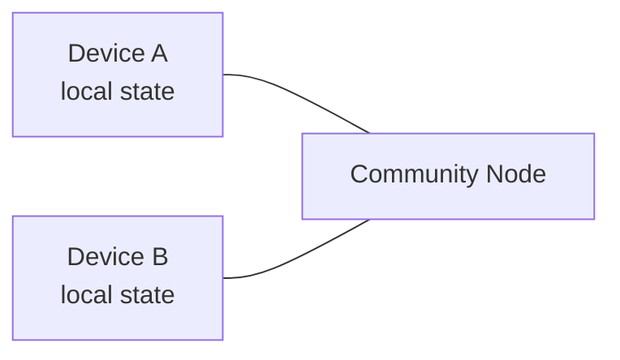

The node is useful because mobile devices are frequently offline, but the community should not become permanently dependent on one server.

### 3.3 Cryptographic Identity

Users and communities should have cryptographic identities independent of infrastructure.

A community is identified by its cryptographic identity, not by `https://community.example.com`. Instead, conceptually:

```
Community ID = hash(community public identity key)
```

A node address is merely a place where the community can currently be reached. This allows:

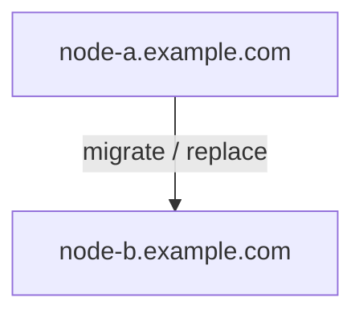

without changing the identity of the community.

## 4. High-Level Architecture

The initial architecture contains two major components.

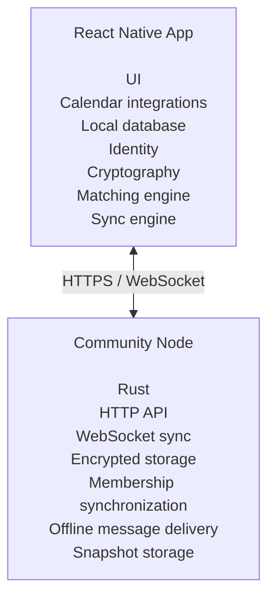

Later, multiple nodes can replicate the same community:

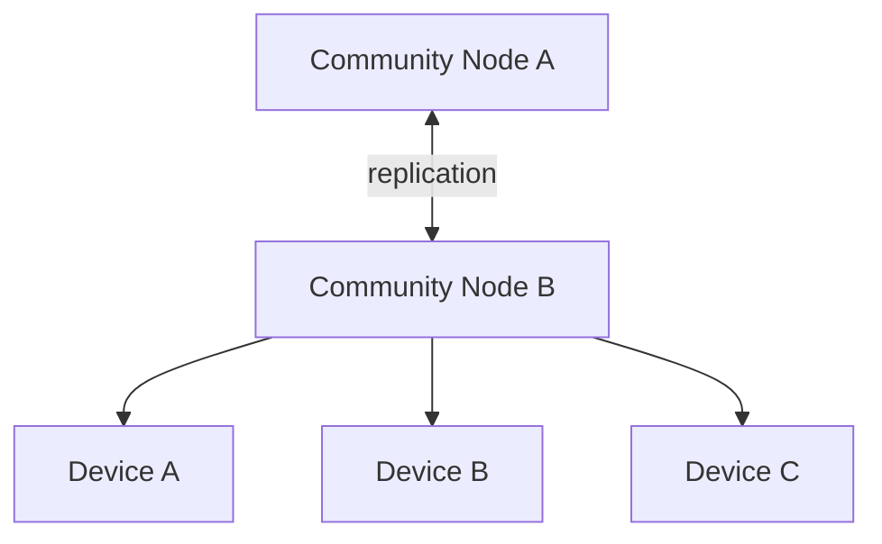

Multi-node replication is not required for the first MVP.

## 5. Mobile Application

### 5.1 Recommended Technology

- React Native;
- TypeScript;
- SQLite;
- native calendar APIs;
- Google Calendar API;
- Microsoft Graph;
- a dedicated cryptographic library;
- a shared TypeScript domain/protocol layer.

The mobile application contains the majority of the business logic.

```
apps/
    mobile/
packages/
    domain/
    protocol/
    crypto/
    sync/
```

Platform-specific code remains isolated in `apps/mobile/ios/` and `apps/mobile/android/`. This gives the project a path toward a future web client without coupling the protocol to React Native.

## 6. Why React Native Instead of a PWA

A PWA is technically capable of implementing much of the architecture. However, UX is a critical requirement for this project. The target users may:

- have limited technical knowledge;
- be uncomfortable with authorization flows;
- be unfamiliar with decentralized systems;
- have older phones;
- require reliable notifications;
- need very clear explanations of what the application is doing.

Therefore, the production client should prioritize native mobile capabilities. React Native provides:

- native push notifications;
- reliable access to platform APIs;
- native calendar integrations;
- better control over lifecycle behavior;
- a familiar mobile-app experience;
- a path to iOS and Android from one codebase.

The decentralized protocol should nevertheless remain independent of React Native.

## 7. User Identity

Every application installation creates a cryptographic identity (public/private signing key pair).

The private key must:

- remain on the user's device;
- never be sent to the community node;
- never be required by the server;
- be protected by the platform's secure storage where possible.

The public key can be shared with communities.

## 8. Separate Signing and Encryption Keys

Do not use one key for every cryptographic purpose. At minimum, distinguish between a **signing identity** and an **encryption identity**.

- Signing answers: *"Did this user actually authorize this operation?"*
- Encryption answers: *"Who is allowed to read this content?"*

This separation makes key rotation and membership management considerably easier.

## 9. Community Identity

A community also has a cryptographic identity: `community_id`, a community public identity key, and community private administrative key material.

The private administrative key material must not simply live in plaintext on the community node. Initially, one administrator may control it. The protocol should eventually support multiple administrators and threshold authorization (e.g. 2 of 3 administrators) for particularly sensitive operations.

## 10. Membership

```
Member {
    user_id
    public_key
    role
    status
    joined_at
    key_epoch
}
```

Possible roles: `member`, `organizer`, `admin`.

Do not trust a server-side role field by itself. Role changes must be represented as signed operations:

```
GrantRole {
    community_id
    user_id
    role: admin
    author
    version
    signature
}
```

Clients can then independently verify that the operation was authorized.

## 11. Joining a Community

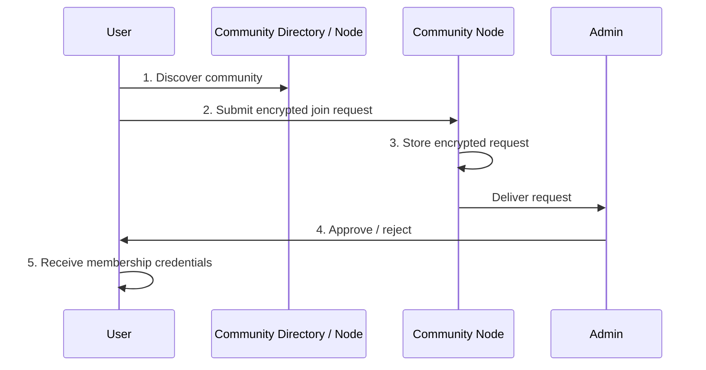

The node does not need to understand the contents of the request.

## 12. Encrypting Join Requests

A join request may contain sensitive information supplied by the applicant. The requester encrypts the request before uploading it, using a hybrid encryption pattern.

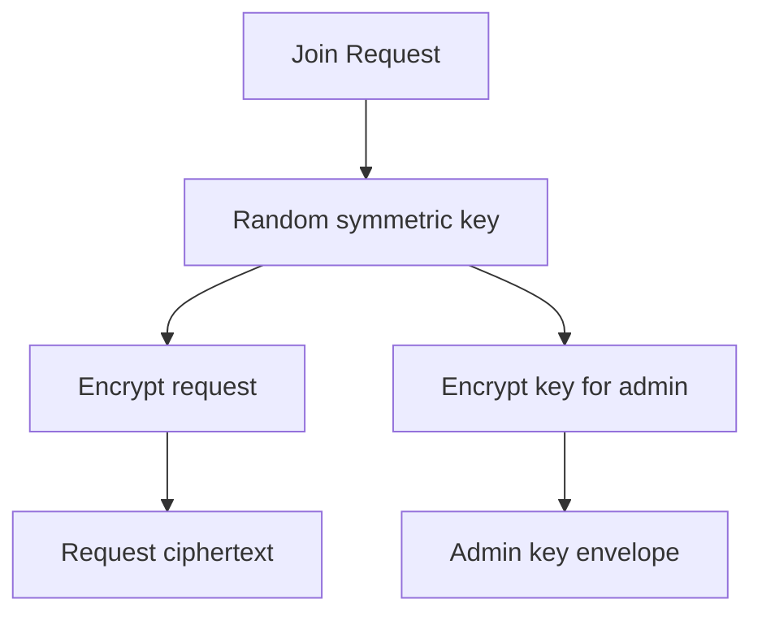

The node simply stores the ciphertext and delivers it to authorized administrators. The node does not have the decryption key.

## 13. Community Encryption Key

Shared community content is protected using an epoch-based symmetric key (e.g. epoch 17, key `K17`). Each member receives an encrypted envelope containing the current community key:

```
Encrypt(K17, MemberA Public Key)
Encrypt(K17, MemberB Public Key)
Encrypt(K17, MemberC Public Key)
```

The community node can store these encrypted envelopes. It does not need access to `K17`.

## 14. Key Rotation

Membership changes require key rotation.

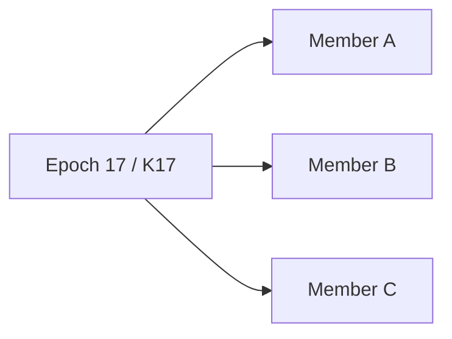

C leaves. Generate epoch 18 / `K18` and distribute only to remaining members:

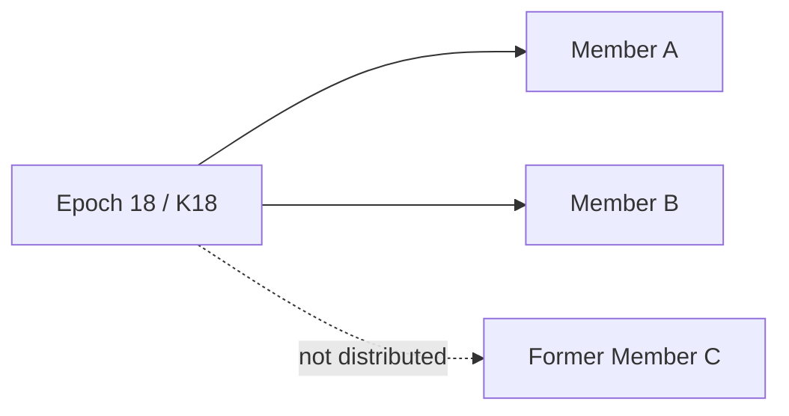

C can continue to decrypt data encrypted under `K17`, because they already legitimately possessed that key. C cannot decrypt new data encrypted with `K18`.

The node does not initiate the rotation. An authorized device does.

## 15. Offline Members During Key Rotation

Key rotation must not require all members to be online. With 100 members, 1 leaving, 50 online and 49 offline, the new key is encrypted for the remaining 99 members. For offline members the node stores their encrypted key envelopes. When a member reconnects:

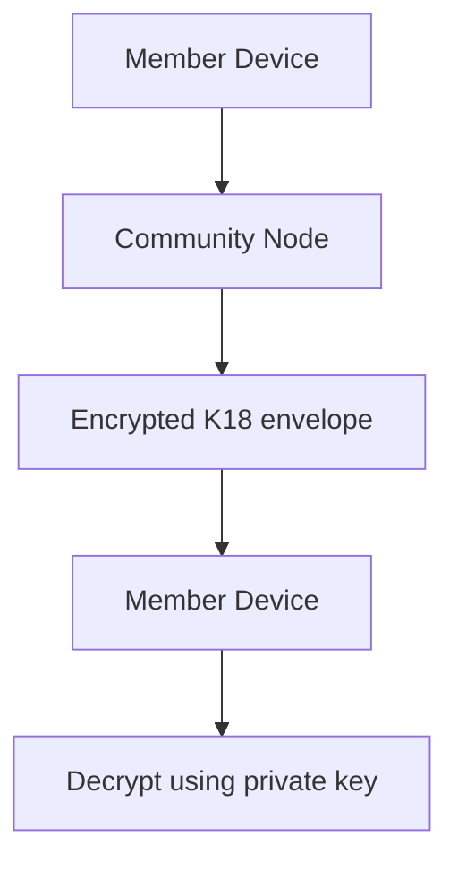

The node never needs to know `K18`.

## 16. Event Model

```
Event {
    id
    title
    description
    starts_at
    ends_at
    location
    capacity
    status
    organizer_id
    created_at
}
```

Depending on privacy requirements, some fields can be public within the community while others remain encrypted.

## 17. Location Model

Precise GPS history should never be required. The user chooses a reference location (Home, Work, Recife, Olinda, a custom location, or a point on a map). The app stores `preferred_location` and `preferred_radius` locally. The user can change the reference point manually — e.g. *"I am currently in Recife, but show me events around São Paulo because I will travel there next week."* — without revealing their current GPS location.

## 18. Calendar Integrations

- **Apple Calendar** — native EventKit. Calendar data stays on the device.
- **Google Calendar** — OAuth 2 with PKCE; the app talks to Google's APIs directly. No client secret in the app.
- **Microsoft Outlook / Calendar** — Microsoft Graph with OAuth and PKCE. Calendar data is processed locally.

## 19. Calendar Matching

The device compares an event (date, time, location) against the local calendar, local preferred location, travel constraints and user preferences, and produces `Available`, `Unavailable` or `Maybe`. The complete personal calendar is never transmitted.

## 20. Volunteer Flow

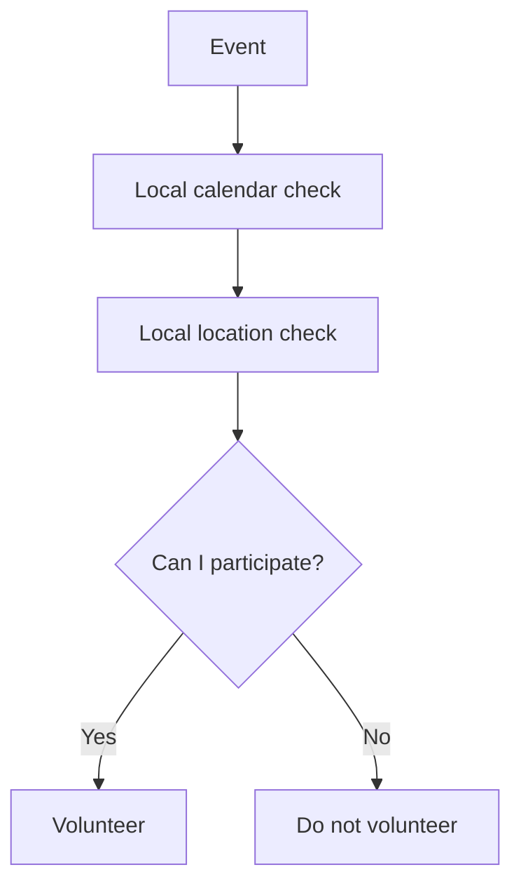

The community receives only the necessary participation request.

## 21. Invitation Flow

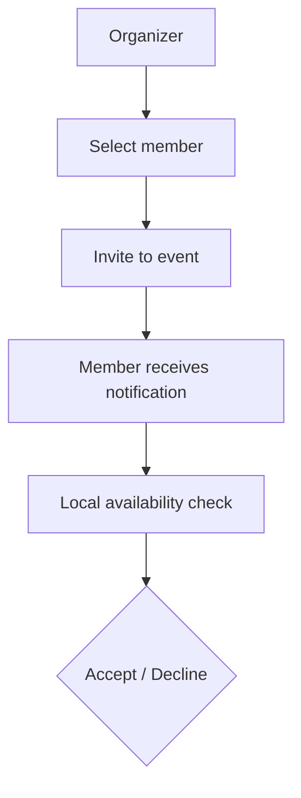

The system must not silently assign people to events. The person must explicitly accept.

## 22. Finding Suitable People

A community may want to *"find people who could reasonably attend this event."* Matching runs on members' devices, and the system exposes only a minimal eligibility signal (`eligible: true`) rather than calendar details. The exact information exposed to organizers is a deliberate privacy decision.

## 23. Community Discovery

A small public directory contains:

```
CommunityDirectoryEntry {
    community_id
    name
    description
    approximate_region
    public_key
    join_policy
    node_addresses
}
```

It must not contain member lists, member locations, availability, calendars or private event details.

## 24. Community Node

A small Rust executable:

```
community-node
    ├── HTTP API
    ├── WebSocket sync
    ├── authentication
    ├── authorization
    ├── encrypted storage
    ├── delivery queue
    ├── snapshot storage
    └── sync protocol
```

Avoid microservices, Kubernetes, Kafka, Redis, and requiring PostgreSQL. The first implementation is **Rust binary + SQLite database**.

## 25. Why SQLite

SQLite is not the same thing as centralizing the application; it is the node's local persistence. The entire node is `community-node` + `community.sqlite` + `config.toml`, and runs on a VPS, Raspberry Pi, home server, NAS, old computer, or any cloud VM.

## 26. Node Storage

Conceptually: `communities`, `members`, `operations`, `snapshots`, `key_envelopes`, `delivery_queue`. Most sensitive content is encrypted before reaching the node.

## 27. Node as a Mailbox

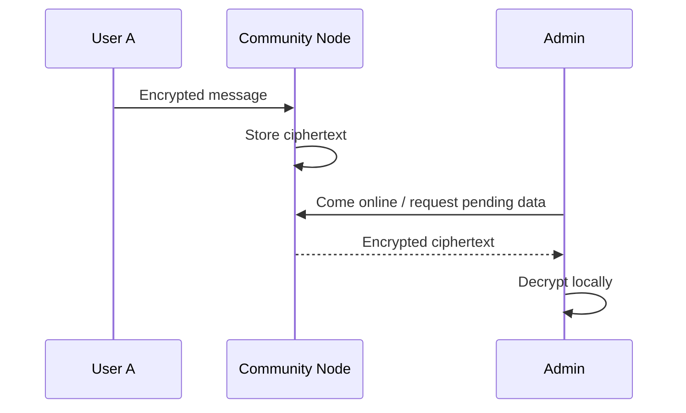

This is the key mechanism that allows offline users to communicate without requiring the recipient to be online.

## 28. Offline Delivery

If the member and admin are offline but the node is online, a new join request is stored as ciphertext and delivered when the admin comes online. No private key needs to exist on the node.

## 29. Node Compromise

An attacker who obtains the entire node database should primarily obtain ciphertexts, public keys, signatures and protocol metadata — **not** calendar contents, personal availability, private community content, private messages or community encryption keys. This is a core security requirement.

## 30. Sync Protocol

Synchronization is version-based. Each community has a monotonically increasing logical version. A device says *"I have version 183"*; the node answers with the current version and the updates after 183.

## 31. Operations

```
Operation {
    operation_id
    community_id
    version
    type
    timestamp
    author
    payload
    signature
}
```

The payload may be encrypted. The signature lets clients verify who authorized the operation.

## 32. Idempotency

Every operation has a globally unique `operation_id`. Receiving the same operation twice applies it once. This is essential because mobile retransmission is normal.

## 33. Resumable Synchronization

If a device disconnects after version 190, it asks for operations after 190 — it does not restart synchronization.

## 34. Snapshots

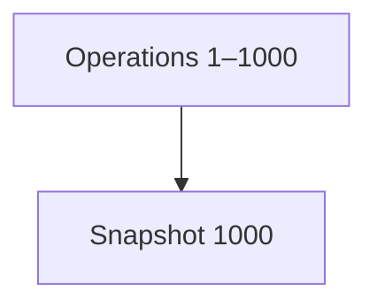

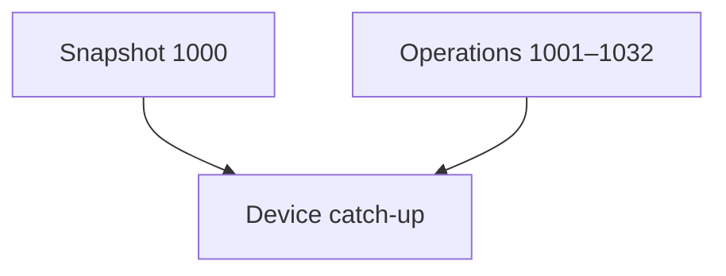

A device that has been offline downloads the snapshot and only the operations after it.

## 35. Event Compaction

An event may generate many operations (created, volunteers, cancellations, invites, acceptances, completion, attendance). After completion the useful state might simply be:

```
EventSummary {
    id
    title
    date
    status: completed
    attendance_count
}
```

or, if individual attendance is required, `attendees: [A, C, D]`. Intermediate operations need not remain forever.

## 36. Retention Policy

| Class | Examples | Retention |
|---|---|---|
| Ephemeral | transient messages, temporary sync metadata, availability probes | hours / days |
| Operational | active events, current memberships, pending invitations and membership requests | until no longer required |
| Historical | completed event summaries, attendance statistics | months / years, per community policy |

## 37. Snapshot Semantics

```
CommunitySnapshot {
    version
    community { id, metadata, key_epoch }
    members { ... }
    active_events { ... }
    completed_event_summaries { ... }
    pending_invitations { ... }
    pending_membership_requests { ... }
}
```

A snapshot never contains personal calendars, GPS history or unrelated personal information.

## 38. Devices Offline for Months

A device offline for 90 days receives the latest snapshot plus updates after it. If old operations were compacted, it receives a newer snapshot.

## 39. Node Failure

The node is not the only copy of community state:

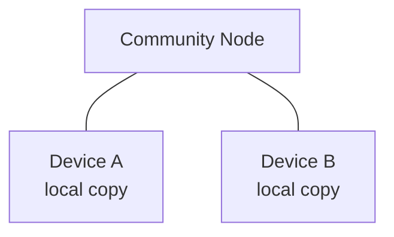

If the node disappears, authorized devices provision a new node and repopulate it.

## 40. Self-Hosted Nodes

```
community-node --community <community-id>
```

Runs on a home computer, Raspberry Pi, NAS, VPS or cloud VM. Open, provider-independent software.

## 41. Managed Nodes

> **Managed hosting must use exactly the same node software as self-hosting.**


A community can migrate between them.

> Implemented in Phase 10: tenants, quotas and an operator API on the same
> binary, and a signed `migrate` control op that freezes the old node and
> that members' devices verify and follow. See
> [`managed-hosting.md`](managed-hosting.md) and protocol §11.3.

## 42. Cost Model

The node mostly performs: store, retrieve, route, sync, verify. Devices perform: calendar matching, location matching, privacy-sensitive computation, encryption/decryption, state reconstruction. Adding users does not proportionally increase server-side computation.

## 43. P2P / WebRTC

WebRTC can be added later to reduce node traffic, but must not be required for correctness. The reliable fallback remains device → node → device, avoiding dependence on NAT traversal, always-online peers, mobile background execution and firewall behavior.

## 44. Conflict Resolution

Operations can arrive in different orders (e.g. accept on device A, decline on device B). The protocol defines deterministic domain rules — for example, once a terminal state is reached, `accepted → declined` may be invalid. Conflict resolution is defined at the domain level rather than relying on timestamps alone.

## 45. Eventual Consistency

Devices may temporarily disagree. After synchronization they converge, provided both possess the necessary authorized data.

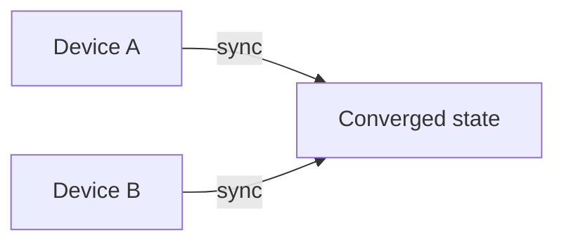

## 46. Cryptographic Verification

Clients independently verify critical operations: who created an event, approved a member, granted admin, removed a member, changed community policy. Operations carry author, signature, operation_id and logical version.

## 47. Security Threat Model

1. compromised community node;
2. malicious administrator;
3. stolen node database;
4. network interception;
5. compromised user account;
6. stolen phone;
7. removed member;
8. destroyed node;
9. replaced node;
10. replayed operation;
11. duplicated operation;
12. long-offline devices.

See [`threat-model.md`](threat-model.md).

## 48. Transport Security

TLS protects data in transit; application-level encryption protects data if the node's database is compromised. Both are required.

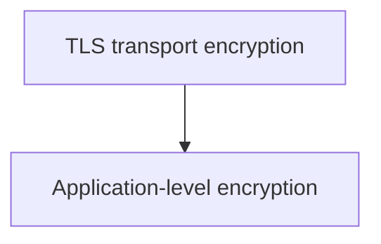

## 49. Metadata Privacy

Encryption does not hide metadata: a node may learn that a user connected, a community received an update, or a message of ~N bytes was stored. The first version does not attempt perfect metadata privacy. The initial objective:

> The node cannot reconstruct users' personal calendars, detailed availability, or encrypted community content from its stored data alone.

## 50. Notifications

Push notifications contain minimal information. Avoid *"You have been invited to a political event at [exact address] at 19:00."* Prefer *"You have a new activity."* The app opens, then fetches and decrypts the content.

## 51. Repository Structure

```
project/
├── apps/
│   ├── mobile/
│   └── node/
├── packages/
│   ├── domain/
│   ├── protocol/
│   ├── crypto/
│   └── sync/
├── crates/
│   ├── crypto/
│   ├── protocol/
│   └── storage/
├── docs/
│   ├── architecture.md
│   ├── protocol.md
│   ├── security.md
│   └── threat-model.md
└── tests/
    ├── protocol/
    ├── crypto/
    ├── sync/
    └── integration/
```

The protocol is specified independently from the implementation.

## 52. Implementation Plan

**Phase 0 — Protocol Specification.** Before any UI, define identities, keys, signatures, community IDs, membership, roles, events, invitations, participation, operations, snapshots, key epochs, synchronization, conflict resolution, retention and node discovery. Deliverable: `docs/protocol.md`. Do not start with the server.

**Phase 1 — Local Domain Engine.** The whole community state machine, locally, no networking: create community, add/remove member, create event, invite, accept, decline, volunteer, complete, attendance, snapshot generation/restoration, operation compaction.

**Phase 2 — Cryptographic Layer.** Identity generation, signatures, encryption, key envelopes, epochs, membership key rotation, encrypted snapshots and operations. Security tests before moving forward.

**Phase 3 — Rust Node.** Rust + SQLite + HTTP + WebSocket. Authenticate devices, store/retrieve encrypted data, maintain versions, deliver pending messages, store snapshots, provide discovery info. No application intelligence in the node.

**Phase 4 — Synchronization.** `sync(since_version)` with resumability, operation IDs, deduplication, signatures, version tracking, acknowledgements, snapshots. Test: device A offline, device B performs 1,000 operations, device A reconnects.

**Phase 5 — Mobile Application.** Built around the local domain engine. UX first. Users never see "CRDT", "epoch", "node", "public key", "encrypted envelope" or "operation log" — they see *Create community, Join community, Create event, Volunteer, Invite, Accept, Decline*.

**Phase 6 — Calendar Integrations.** Apple EventKit, then Google Calendar, then Microsoft Graph. Read-only, availability calculated locally.

**Phase 7 — Location Matching.** Preferred, current and manually selected location; radius; approximate travel distance/time. Never require precise location sharing.

**Phase 8 — Real-World Offline Testing.** User offline 24 h / 7 d / 30 d; node offline, destroyed, replaced; admin offline; all admins offline; conflicting operations; flapping connections. More important than performance benchmarks at this stage.

**Phase 9 — Community Node Deployment.** One binary that runs anywhere; Docker image + standalone binary, Docker optional; minimal configuration.

**Phase 10 — Managed Hosting.** Only after self-hosting works. The protocol must not depend on AWS, GCP, Azure, Cloudflare, Supabase or Firebase.

## 53. Testing Strategy

- **Unit tests** — state transitions, cryptographic operations, serialization, snapshots, key rotation, permissions.
- **Property tests** — random operations delivered in random order, duplicated, delayed, partially missing; resulting valid state must be deterministic.
- **Integration tests** — devices A, B, C plus a node with simulated network failures.
- **Security tests** — node compromised ⇒ protected content unreadable; member removed ⇒ new epoch ⇒ former member cannot decrypt new data.

## 54. First MVP Scope

- **Users** — identity, profile, community membership.
- **Communities** — create, discover, request to join, approve, reject, remove member.
- **Events** — create, edit, cancel, volunteer, invite, accept, decline, complete.
- **Privacy** — encrypted community state, local calendar matching, local location matching.
- **Infrastructure** — one Rust node, SQLite, offline synchronization, snapshots.
- **Platforms** — iOS, Android.

## 55. Features to Delay

WebRTC, multi-node consensus, threshold signatures, advanced anonymous credentials, complex public directories, sophisticated distributed discovery, serverless functions, Kubernetes, blockchain.

## 56. Most Important Architectural Decisions

> **The community node stores enough encrypted state to allow offline users to synchronize, but it does not become the authoritative owner of users' private data.**

> **The operation log is a synchronization mechanism; the snapshot is the durable representation of meaningful state.**

The system retains history only when that history is actually useful.

## 57. Final Architecture

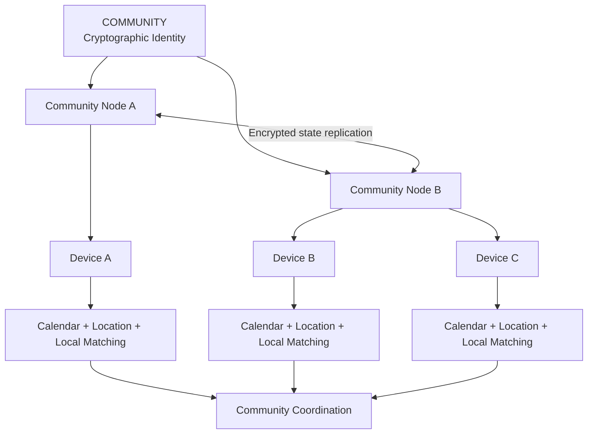

```mermaid
flowchart TD
    subgraph P[Private data stays on the user device]
        C[Calendar] --> D[User Device]
        L[Location] --> D
        R[Preferences] --> D
        D --> A[Local availability / matching]
        D --> E[Local encryption]
    end
    E -->|Minimal encrypted community data| N[Community Node]
    N -->|Encrypted state| O[Other devices]
```

## 58. Bottom Line

The system is not serverless in the traditional cloud sense. It is:

> **local-first + federated + self-hostable + encrypted + eventually consistent.**

A community can run *Rust binary + SQLite* on a small VPS, a Raspberry Pi, or an administrator's always-on computer, while a managed provider offers the same node as a paid service. The infrastructure provider is replaceable; the community identity, users' identities, encrypted state, protocol and application remain independent of the machine running the node.
