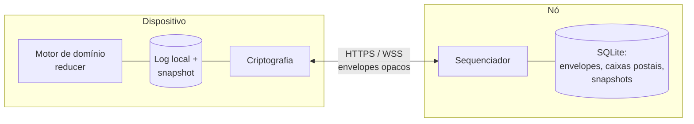
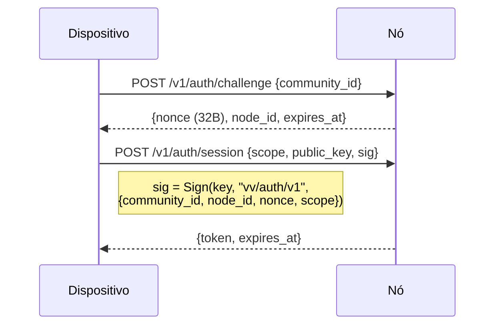
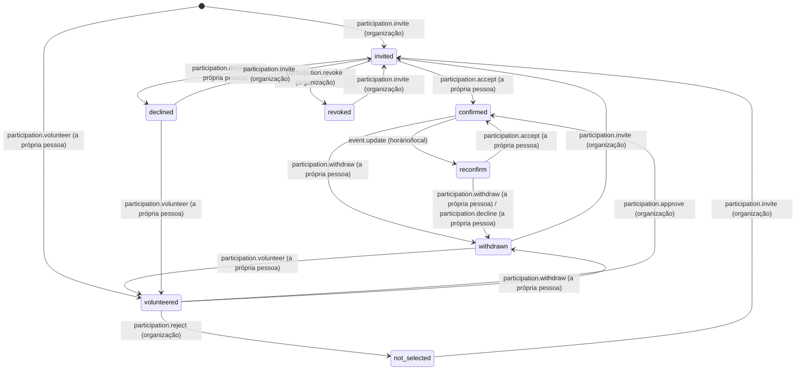

# Especificação do Protocolo — v0 (rascunho)

> Status: **rascunho da Fase 0.** Normativo para implementações das Fases 1–4.
> Mudanças incompatíveis são esperadas até a v1. Seções marcadas com **[MVP]**
> devem ser implementadas na primeira versão utilizável; seções **[LATER]**
> estão especificadas para que o MVP não se encurrale, mas ainda não precisam
> ser construídas.
>
> As palavras-chave MUST, SHOULD, MAY são usadas como na RFC 2119.

Este documento transforma [`architecture.md`](architecture.md) em regras
concretas e implementáveis. Onde ele diverge do documento de arquitetura ou o
torna mais preciso, a divergência é destacada em uma **Nota de projeto**.

---

## 0. Visão geral



- Uma **comunidade** é um **log** replicado, somente de acréscimo (append-only),
  de **operações**.
- O **estado** da comunidade é uma função pura e determinística do log:
  `state = fold(reduce, genesis, log)`.
- O **nó** é um *sequenciador e caixa postal*: ele atribui a cada operação
  aceita uma posição (`seq`) no log e armazena o texto cifrado. Ele não
  consegue ler, forjar nem validar conteúdo de domínio.
- Os **dispositivos** decifram, verificam assinaturas e executam o reducer.
  Todo dispositivo que possui o log calcula o mesmo estado.
- Os **snapshots** permitem que os dispositivos pulem o prefixo do log e que o
  nó o apague.

Dois planos:

| Plano | Legível pelo nó | Usado para |
|---|---|---|
| **Plano de controle** | Sim (somente cabeçalhos) | Coisas que o nó precisa impor: quem pode escrever, quem pode rotacionar chaves, gênese |
| **Plano de dados** | Não | Todo o resto: perfis, filiação, eventos, participação |

O plano de controle é intencionalmente minúsculo. Tudo o que não é necessário
para o nó fazer controle de acesso vive no plano de dados.

---

## 1. Convenções

### 1.1 Codificação

- Todas as estruturas são codificadas como **CBOR determinístico** (RFC 8949
  §4.2.1, "Core Deterministic Encoding"): comprimentos definidos, inteiros na
  forma mais curta, chaves de mapa ordenadas byte a byte.
- As chaves de mapa são strings de texto curtas, conforme dadas neste
  documento.
- Strings de bytes são do tipo maior 2 do CBOR. Em URLs e em visualizações de
  depuração em JSON, são representadas como **hex em minúsculas**.
- Timestamps são inteiros em **milissegundos desde a época Unix, UTC** (`u64`).
  Timestamps produzidos por dispositivos são *indicativos* — nunca são usados
  para ordenação ou resolução de conflitos (ver §8).
- Identificadores que não são hashes (`op_id`, `event_id`, …) são 16 bytes
  aleatórios de um CSPRNG.

### 1.2 Separação de domínio

Todo uso de hash, KDF, assinatura e AEAD carrega uma string de contexto. As
strings de contexto são ASCII, prefixadas com `vv/` e versionadas, por exemplo
`vv/op-sig/v1`. A lista canônica está na §15. Uma assinatura é sempre
calculada sobre:

```
ctx_len (1 byte) || ctx || cbor(signed_struct_without_sig)
```

Hashes usados como identificadores ou resumos (`community_id`, `member_id`,
`mailbox_id`, `entry_hash`, `state_hash`, hashes de convite) são
`SHA-256(ctx || data)`, sem o byte de comprimento. As strings de contexto de
KDF são o `info` do HKDF. O HPKE usa `info = ctx || binding fields`.

Dentro de `SignedOp.body` (o payload de domínio, §9), identificadores e chaves
(`member_id`, `event_id`, `msk`, `mek`, …) são **texto hex em minúsculas** na
v0; em todo o resto deste documento, `bytes(n)` significa uma string de bytes
CBOR.

### 1.3 Suíte criptográfica `VV1`

| Finalidade | Primitiva |
|---|---|
| Assinaturas | Ed25519 (RFC 8032), verificação estrita (rejeita S não canônico, A de ordem pequena) |
| Acordo de chaves / envelopes | HPKE (RFC 9180) modo base, `DHKEM(X25519, HKDF-SHA256)`, `HKDF-SHA256`, `ChaCha20Poly1305` |
| AEAD simétrico | XChaCha20-Poly1305, nonce aleatório de 24 bytes |
| Hash | SHA-256 |
| KDF | HKDF-SHA256 |

Justificativa: todas estão disponíveis como implementações puras auditadas em
ambas as stacks (`@noble/*` em TypeScript; `ed25519-dalek`, `x25519-dalek`,
`hpke`, `chacha20poly1305`, `sha2` em Rust), sem necessidade de módulos
nativos no React Native. O identificador da suíte vai na gênese, para que uma
futura `VV2` possa ser introduzida por comunidade.

---

## 2. Identidades e chaves

### 2.1 Inventário de chaves

| Chave | Tipo | Mantida por | Escopo | Visível ao nó |
|---|---|---|---|---|
| **Chave raiz da comunidade** `CRK` | Ed25519 | admin(s) fundador(es), pode ficar offline | por comunidade, de longa duração | metade pública |
| **Chave de assinatura do membro** `MSK` | Ed25519 | dispositivo do membro | por *(pessoa, comunidade)* | apenas para admins e autenticação de caixa postal (ver §3) |
| **Chave de cifragem do membro** `MEK` | X25519 | dispositivo do membro | por *(pessoa, comunidade)* | não |
| **Chave de época** `K_e` | simétrica de 32 bytes | todos os membros da época `e` | por época da comunidade | não |
| **Chave de acesso da época** `EAK_e` | Ed25519, derivada de `K_e` | todos os membros da época `e` | por época da comunidade | metade pública |
| **Chave de entrada** `IK` | X25519 | admins | por comunidade | metade pública (na entrada do diretório) |
| **Chave raiz da pessoa** `PRK` | Ed25519 | dispositivo | global, opcional | nunca |

> **Nota de projeto — chaves de membro por comunidade.** A arquitetura
> descreve uma identidade por instalação. Esta especificação, em vez disso,
> faz cada dispositivo gerar um novo par de chaves de assinatura + cifragem
> **para cada comunidade em que entra**. Um nó que hospeda várias comunidades,
> ou dois nós em conluio, portanto, não conseguem vincular as filiações de uma
> pessoa pela chave pública. Para organização política esse vínculo é um risco
> real, e o custo é desprezível (um par de chaves por comunidade). A `PRK`
> opcional permite que uma pessoa *escolha* provar "sou a mesma pessoa da
> comunidade X" dentro de dados de perfil cifrados. Isso substitui "user_id"
> no registro `Member` da arquitetura por `member_id` (§2.2).

### 2.2 Identificadores derivados

```
community_id = SHA-256("vv/community-id/v1" || CRK.public)    # 32 bytes
member_id    = SHA-256("vv/member-id/v1"    || MSK.public)    # 32 bytes
mailbox_id   = SHA-256("vv/mailbox-id/v1"   || community_id || MSK.public)
```

Representação de `community_id` para humanos: base32 RFC 4648 em minúsculas,
sem preenchimento, prefixado com `vv1`, por exemplo `vv1q3f…`. As interfaces
SHOULD mostrar uma impressão digital curta (os primeiros 8 caracteres base32,
agrupados) para verificação fora de banda, nunca o ID completo.

### 2.3 Derivações da chave de época

A partir de `K_e` (32 bytes), usando HKDF-SHA256 com `salt = community_id || u32be(e)`:

```
op_key_e        = HKDF(K_e, info="vv/op-key/v1")         # chave AEAD para operações do plano de dados
snapshot_key_e  = HKDF(K_e, info="vv/snapshot-key/v1")   # chave AEAD para snapshots
EAK_e.seed      = HKDF(K_e, info="vv/epoch-access/v1")   # semente Ed25519
```

`EAK_e` é a **credencial de grupo**: possuí-la prova ao nó "sou membro da
época atual" sem dizer ao nó *qual* membro.

### 2.4 Armazenamento de chaves nos dispositivos

- `MSK`, `MEK`, `PRK` e toda `K_e` MUST ser armazenadas no enclave seguro /
  keystore da plataforma, quando disponível (Keychain do iOS com
  `kSecAttrAccessibleAfterFirstUnlockThisDeviceOnly`; chave envolvida pelo
  Android Keystore). Material de chave bruto MUST NOT ser gravado no banco
  SQLite sem cifragem.
- A `CRK` SHOULD, além disso, poder ser exportada como uma folha de
  recuperação impressa (lista de palavras no estilo BIP-39 sobre a semente de
  32 bytes) para o admin fundador. A perda da `CRK` é contornável (ver §11.4),
  mas não é o ideal.

---

## 3. Autenticação no nó

O nó nunca vê uma senha ou conta. Ele autentica **capacidades**:

| Escopo | Credencial | Concede |
|---|---|---|
| `community` | assinatura pela `EAK_e` atual | ler/escrever o log da comunidade, ler/escrever snapshots, postar em qualquer caixa postal da comunidade |
| `mailbox` | assinatura por uma `MSK` cujo `mailbox_id` é o endereçado | ler/confirmar essa única caixa postal |
| `control` | assinatura por uma `MSK` no **conjunto de admins** do nó | submeter operações do plano de controle |
| `intake` | nenhuma (com limite de taxa), ou um token de convite | submeter pedidos de entrada |

### 3.1 Handshake [MVP]



- `node_id` é a própria chave pública Ed25519 do nó (ver §11.1). Vinculá-la à
  assinatura impede que um nó malicioso repasse um desafio para outro nó.
- Os tokens são opacos, com ≥ 128 bits aleatórios, TTL ≤ 24 h, vinculados ao
  escopo.
- Um dispositivo normalmente mantém dois tokens por comunidade: `community`
  (via `EAK_e`) e `mailbox` (via sua `MSK`). Admins também mantêm `control`.

> **Nota de projeto — o que o nó descobre.** O nó descobre a metade pública da
> `EAK_e` (compartilhada por todos os membros — não revela nada individual), a
> chave pública `MSK` de cada dispositivo que consulta sua caixa postal
> (pseudônima, por comunidade) e as chaves públicas do conjunto de admins. Ele
> não descobre nomes de membros, a lista de membros nem papéis além de admin.
> Esse é o significado concreto de "o nó não recebe a confiança de guardar
> dados privados em texto claro".

---

## 4. Formato das operações

### 4.1 Envelope (o que o nó armazena)

```
OpEnvelope {
  v:       1
  cid:     bytes(32)        # community_id
  op_id:   bytes(16)
  epoch:   u32
  plane:   "d" | "c"        # dados | controle
  ctrl:    ControlHeader?   # presente sse plane == "c"
  nonce:   bytes(24)
  ct:      bytes            # XChaCha20-Poly1305(op_key_epoch, nonce, cbor(SignedOp), aad)
  asig:    bytes(64)        # Sign(EAK_epoch, "vv/op-access/v1", envelope_without_asig)
}
aad = cbor({v, cid, op_id, epoch, plane, ctrl})
```

Verificações do lado do nó antes de aceitar (todas baratas, nenhuma exige
chaves):

1. `cid` está hospedado aqui; `epoch == current_epoch` (ou `current_epoch - 1`
   dentro da janela de tolerância, §7.4).
2. `asig` é verificada sob `EAK_epoch.public`.
3. `op_id` ainda não está presente → caso contrário, retorna o `seq` existente
   (idempotente, §6.3).
4. Para `plane == "c"`: verificações do plano de controle (§5).
5. Tamanho ≤ `max_op_bytes` (padrão 64 KiB).

### 4.2 Entrada de log (o que o nó retorna)

```
LogEntry {
  seq:    u64          # atribuído pelo nó, começa em 1 (gênese)
  prev:   bytes(32)    # hash da LogEntry anterior; gênese: 32 bytes zero
  env:    OpEnvelope
  at:     u64          # hora de recebimento no nó (indicativa)
}
entry_hash = SHA-256("vv/log-entry/v1" || cbor({seq, prev, env, at}))
```

`at` é coberto pelo hash porque ele determina o relógio de retenção (§12.2):
um nó não pode ser capaz de mostrar horários diferentes a dispositivos
diferentes para a mesma entrada.

A cadeia `prev` permite que qualquer dispositivo que tenha duas entradas
detecte um nó que reescreveu o histórico (§13).

### 4.3 Operação assinada (dentro do texto cifrado)

```
SignedOp {
  op_id:    bytes(16)   # MUST ser igual ao op_id do envelope
  cid:      bytes(32)   # MUST ser igual ao cid do envelope
  epoch:    u32         # MUST ser igual à epoch do envelope
  author:   bytes(32)   # MSK.public do autor
  base:     u64         # maior seq que o autor já tinha aplicado ao criar esta operação
  ts:       u64         # relógio do autor, indicativo
  type:     text        # ex.: "event.create"
  body:     map         # específico do tipo, §9
  sig:      bytes(64)   # Sign(MSK, "vv/op-sig/v1", SignedOp_without_sig)
}
```

A assinatura interna vincula `op_id`, `cid` e `epoch`, de modo que um membro
não consegue transplantar a operação assinada de outro membro para um
envelope, comunidade ou época diferente.

> **Nota de projeto — assinar e depois cifrar.** A identidade do autor fica
> dentro do texto cifrado, então o nó não consegue saber quem escreveu o quê.
> O nó verifica apenas `asig` ("algum membro atual escreveu isto"); os
> dispositivos verificam `sig` ("este membro específico escreveu isto").

---

## 5. Plano de controle [MVP]

As operações do plano de controle carregam um `ControlHeader` em texto claro,
que o nó impõe, mais um `SignedOp` cifrado com os detalhes significativos
para humanos.

```
ControlHeader {
  kind:     "genesis" | "rotate" | "admin.set" | "migrate"
  signer:   bytes(32)      # MSK.public de um admin, ou CRK.public para gênese / recuperação
  csig:     bytes(64)      # Sign(signer, "vv/ctrl-sig/v1", {cid, op_id, epoch, kind, args})
  args:     map            # específico do kind, abaixo
}
```

| kind | args | O nó impõe |
|---|---|---|
| `genesis` | `{suite: "VV1", crk: CRK.public, admins: [MSK.public], eak: EAK_0.public, ik: IK.public}` | `signer == crk`; `SHA-256(ctx‖crk) == cid`; válido apenas como `seq 1` |
| `rotate` | `{new_epoch: u32, eak: EAK_new.public}` | `signer ∈ admin_set`; `new_epoch == current_epoch + 1` |
| `admin.set` | `{admins: [MSK.public], ik: IK.public?}` | `signer ∈ admin_set` **ou** `signer == crk`; conjunto não vazio |
| `migrate` | `{nodes: [text]}`: 0–5 URLs base, cada uma `http(s)://` seguida de ASCII imprimível (0x21–0x7E), ≤ 200 bytes | `signer ∈ admin_set` **ou** `signer == crk`; depois disso, toda escrita exceto `migrate` é recusada com `moved` (§11.3). Uma lista vazia cancela uma mudança |

`rotate` e `admin.set` são cifradas sob a chave da época **antiga** (a que
está em `epoch`), e o nó troca `current_epoch` depois de aceitar um `rotate`.

`admin.set` assinado pela `CRK` é o **caminho de recuperação**: se todos os
dispositivos de admin forem perdidos ou um admin se tornar hostil, quem detém
a `CRK` pode redefinir o conjunto de admins.

Os dispositivos MUST verificar novamente, de forma independente, todo
cabeçalho de controle — a imposição pelo nó é uma conveniência, não uma âncora
de confiança.

O `SignedOp.type` interno de uma operação de controle é `community.init`
(gênese), `epoch.rotate`, `admin.set` ou `community.migrate`, e seu `author`
MUST ser igual a `ctrl.signer`. Listas de nós de `migrate` malformadas falham
na decodificação do envelope (`malformed`) em ambos os lados;
`tests/vectors/vv1.json` traz casos.
O **efeito de uma entrada de controle vem apenas do seu cabeçalho**, verificado
exatamente com as regras da tabela acima: o nó não consegue ler o corpo, então
qualquer condição extra do lado do dispositivo permitiria que dispositivos e nó
discordassem sobre a época atual ou o conjunto de admins. Um corpo ilegível, ou
cujo type/author não corresponde ao cabeçalho, é ignorado (resultado
`opaque`). Operações do plano de dados que carregam um tipo interno de controle
são rejeitadas como `malformed`.

> **Nota de projeto — conjunto de admins em texto claro.** O nó precisa recusar
> rotações de chave vindas de não admins; caso contrário, qualquer membro (ou
> um membro removido antes de a rotação chegar) poderia se apoderar da época.
> Isso exige que o nó conheça as chaves públicas dos admins. Elas continuam
> sendo chaves pseudônimas por comunidade. Assinaturas de admin com limiar
> (k-de-n) **[LATER]** se encaixam aqui, permitindo que `csig` seja uma lista e
> adicionando `threshold` a `admin.set`.

---

## 6. Sincronização [MVP]

### 6.1 Modelo de ordenação

O nó atribui `seq` na ordem em que aceita os envelopes. **A ordem de `seq` é a
ordem canônica do log** e, portanto, do reducer.

> **Nota de projeto — por que um sequenciador em vez de um CRDT.** A
> arquitetura pede "uma versão lógica monotonicamente crescente" e regras de
> domínio determinísticas (§44). Um sequenciador de nó único entrega as duas
> coisas com muito menos complexidade que um CRDT e mantém o reducer simples:
> as operações são aplicadas uma de cada vez sobre o estado atual e são ou
> *válidas* (aplicadas) ou *rejeitadas* (registradas, sem efeito). O nó pode
> atrasar ou reter operações, mas não pode forjá-las nem alterá-las, e uma
> reordenação é detectável pelo campo `base` e pela cadeia de hashes (§13). A
> replicação em múltiplos nós **[LATER]** mantém um único sequenciador por
> comunidade (o "primário"), com os outros nós como réplicas e failover; ela
> não precisa de consenso.

### 6.2 Laço de sincronização do dispositivo

```
loop:
  push:  POST pending local ops (batch, idempotent)
  pull:  GET ops after local_seq
         if 410 Gone → fetch latest snapshot, restore, retry pull
  apply: for each entry in seq order:
           verify prev-chain, asig, decrypt, verify sig, reduce
  mbox:  GET mailbox items, process, ack
  wait:  WebSocket "head" notification, or backoff timer
```

Regras do cliente aprendidas na Fase 4 (`packages/sync`):

- A fila de saída armazena a operação (type, body, `op_id`), não o seu
  envelope. Cada envio a sela novamente sob a época mais recente que o
  dispositivo possui, mantendo o `op_id`, de modo que uma operação escrita
  antes de uma rotação ainda chegue depois dela.
- `op_conflict` num reenvio significa que um envio anterior daquele `op_id`
  foi aceito e sua resposta se perdeu: a operação está no log; remova-a da
  fila de saída.
- Um membro ativo que encontra uma entrada sob uma época mais nova do que
  qualquer chave que ele possui **para de puxar** (`waiting_for_key`) em vez de
  processar entradas opacas, e retoma quando o envelope de chave chega. Membros
  removidos seguem adiante (opaco é o correto para eles).
- Ordem de uma sincronização: caixa postal (chaves podem ter chegado), depois
  push, depois pull.

Operações criadas localmente são aplicadas de forma **otimista** a uma camada
pendente (exibida na interface como "enviando…") e reaplicadas na ordem
canônica assim que voltam com um `seq`. Se a aplicação canônica as rejeitar, a
interface mostra o motivo da rejeição (§8.3).

### 6.3 Idempotência

- O nó mantém `op_id → seq` para toda operação que já aceitou, **incluindo as
  compactadas** (16 + 8 bytes por operação; 10 M operações ≈ 240 MB no pior
  caso — tranquilo para SQLite; pode ser podado após `op_id_retention`, padrão
  de 1 ano).
- O reenvio de um `op_id` conhecido retorna `200 {seq}` sem efeitos
  colaterais.
- Os dispositivos MUST NOT reutilizar um `op_id` para conteúdos diferentes. Um
  nó que recebe um `op_id` conhecido com um hash de envelope diferente retorna
  `409 Conflict` e registra o ocorrido.

### 6.4 Retomada

O pull é sempre `after=<last applied seq>`. Não há estado de sessão no nó além
do token de autenticação; qualquer interrupção é retomada a partir do
`local_seq` persistido no dispositivo.

### 6.5 Confirmações de recebimento

- Entradas de log não são confirmadas (são compartilhadas e retidas até a
  compactação).
- Itens da caixa postal são confirmados item a item; itens confirmados são
  apagados.
- Os dispositivos MAY informar `PUT /v1/c/{cid}/cursor {seq}` (escopo
  community, sem autenticação quanto a *qual* membro) para que o nó e os
  admins vejam um histograma anônimo do quanto os dispositivos estão
  atrasados, o que orienta a compactação.

---

## 7. Épocas e distribuição de chaves [MVP]

### 7.1 Envelope de chave

```
KeyEnvelope {
  cid:       bytes(32)
  epoch:     u32
  recipient: bytes(32)     # MEK.public do destinatário
  enc:       bytes(32)     # chave encapsulada do HPKE
  ct:        bytes         # HPKE.Seal(info="vv/key-env/v1"||cid||u32be(epoch),
                           #           aad=cbor({cid, epoch, recipient}), pt=K_epoch)
}
```

Os envelopes são entregues pela **caixa postal** do destinatário (§10), e não
embutidos no log — isso mantém as operações `rotate` com tamanho O(1),
independentemente do número de membros.

### 7.2 Quando rotacionar

| Evento | Rotacionar? |
|---|---|
| membro removido / sai | **MUST** |
| admin removido | **MUST** (emitir também `admin.set` e nova `IK`) |
| membro entra | SHOULD NOT por padrão; a política da comunidade `rotate_on_join` MAY habilitar |
| suspeita de comprometimento de dispositivo | MUST |
| agendada | MAY (política, por exemplo a cada 90 dias) |

### 7.3 Procedimento de rotação (dispositivo de admin)

1. Gerar `K_{e+1}`; derivar `EAK_{e+1}`.
2. Calcular a lista de destinatários a partir do estado **local** (todos os
   membros ativos depois da mudança).
3. Submeter a operação de controle `rotate {new_epoch: e+1, eak}` cifrada sob
   `K_e`; seu `SignedOp.body` = `{reason, removed: [member_id]}`.
4. Ao ser aceita, postar um `KeyEnvelope` por destinatário na caixa postal
   dele, autenticado com `EAK_{e+1}`.
5. Persistir `K_{e+1}` localmente; começar a escrever sob a época `e+1`.

Membros offline recebem seu envelope pela caixa postal sempre que voltarem, sem
limite de tempo (envelopes da época atual são isentos do TTL da caixa postal).

### 7.4 Janela de tolerância

Depois de um `rotate`, o nó continua aceitando envelopes sob `e` (assinados
pela `EAK_e`) durante `epoch_grace` (padrão de 10 minutos). Isso permite que
operações criadas logo antes da rotação cheguem sem uma ida e volta. Envelopes
do plano de dados sob `e` nunca são aceitos depois da janela de tolerância; os
dispositivos cifram novamente as operações ainda pendentes sob a nova época e
as reenviam com o mesmo `op_id`. (O nó não consegue inspecionar `base`, que é
cifrado, então a janela é puramente baseada em tempo.)

> Membros removidos também podem usar a janela de tolerância; suas operações
> tardias são então **rejeitadas pelo reducer** (autor não é membro ativo
> naquele `seq`), de modo que a janela é um recurso de disponibilidade, não uma
> brecha de segurança.

### 7.5 Rotações concorrentes

Dois admins rotacionando ao mesmo tempo miram ambos `e+1`; o nó aceita a
primeira e rejeita a segunda com `409 epoch_conflict`. O admin perdedor
descarta sua `K_{e+1}`, sincroniza e tenta de novo se o seu motivo ainda se
aplicar (por exemplo, o membro que ele queria remover não foi removido pela
rotação vencedora).

### 7.6 Acesso ao histórico

Um novo membro recebe apenas a `K_e` atual. Ele lê o estado da comunidade a
partir do **snapshot mais recente** (cifrado sob a época atual, §12) em vez de
decifrar o histórico. Entradas de log mais antigas continuam ilegíveis para
ele — isso é uma propriedade de privacidade deliberada, não uma lacuna.

---

## 8. Semântica do reducer e resolução de conflitos [MVP]

### 8.1 Determinismo

`reduce(state, entry) → (state', outcome)` MUST ser uma função pura de suas
entradas: sem relógios, aleatoriedade, locale ou E/S. Ponto flutuante MUST NOT
ser usado. A iteração sobre mapas MUST seguir a ordem das chaves ordenadas.

### 8.2 Ordem de validação

Para cada entrada de log, um dispositivo:

1. verifica a cadeia `prev`;
2. verifica `asig`;
3. se `plane == "c"`, verifica o `ControlHeader` em relação ao estado atual
   (§5); para entradas do plano de dados, verifica
   `epoch ∈ {current, current − 1}` (caso contrário, `stale_epoch`);
4. decifra `ct`; se não tiver `K_epoch`, marca a entrada como **opaca** e para
   (ela será coberta por um snapshot posterior). Um dispositivo que *consegue*
   decifrar uma entrada mas não tem a EAK para verificar sua `asig` trata isso
   como falha de integridade, não como conteúdo: o nó pode tê-la fabricado;
5. verifica `SignedOp.sig` e o vínculo `op_id/cid/epoch`. Uma falha aqui
   significa que um membro (que possui `K_epoch` e `EAK_epoch`) produziu algo
   inválido, por exemplo transplantou a operação assinada de outro membro para
   um novo envelope ou assinou como outra pessoa. A entrada é tratada como
   **opaca**: não tem efeito e não pode ser atribuída ao autor alegado;
6. verifica a **autorização** de `author` neste ponto do log (papel, status);
7. verifica se a **transição da máquina de estados** (§9) é legal;
8. aplica, ou registra `rejected(reason)`.

Operações rejeitadas permanecem no log e são inofensivas. Os motivos de
rejeição são enumerados (`not_member`, `not_authorized`, `illegal_transition`,
`capacity_full`, `unknown_target`, `malformed`, …) para que a interface do
autor possa dizer *"Sua aceitação chegou depois que o evento foi cancelado."*

### 8.3 Regra de conflito

Como toda operação é avaliada em relação ao estado produzido por todas as
operações anteriores, a regra geral de conflito é simplesmente: **a primeira
operação válida na ordem de `seq` vence; operações posteriores que deixaram de
ser legais são rejeitadas.** As máquinas de estados do domínio são projetadas
para que isso produza resultados sensatos (estados terminais são terminais,
cancelamentos prevalecem, membros sempre podem se retirar).

### 8.4 Tipos de operação desconhecidos

Os dispositivos MUST tratar valores de `type` desconhecidos como
`rejected(unknown_type)` sem erro, para que clientes mais novos possam
introduzir tipos sem quebrar os mais antigos. Uma comunidade MAY definir
`min_client_version` na política para forçar atualizações quando um novo tipo
afeta estado relevante para a segurança.

---

## 9. Operações de domínio [MVP]

Todos os corpos abaixo são o `SignedOp.body`. "Org" = organizador ou admin.
Os papéis são hierárquicos: `admin ⊃ organizer ⊃ member`.

### 9.1 Comunidade e política

| type | body | quem | efeito |
|---|---|---|---|
| `community.init` | `{name, description, region?, policy, founders: [{msk, mek, profile}]}` | um admin fundador | Metade cifrada da gênese; MUST estar em `seq 1`. `founders` MUST ser exatamente os `admins` da gênese; eles começam como admins ativos. |
| `community.update` | `{name?, description?, region?}` | admin | |
| `policy.update` | `{policy}` | admin | Substitui a política por inteiro. |

```
Policy {
  join:                  "invite_only" | "request" | "open_request"   # ver §10.3
  rotate_on_join:        bool        = false
  volunteer_mode:        "confirm" | "auto"     = "confirm"
  participation_visible: "community" | "organizers" = "community"
  retention: {
    completed_event_detail_days: u32 = 30    # depois, reduzido a EventSummary
    keep_attendee_list:          bool = false
    removed_member_detail_days:  u32 = 30    # depois, o perfil é descartado
    rejected_join_request_days:  u32 = 7
  }
  min_client_version: text?
}
```

### 9.2 Filiação

```
MemberRecord {
  member_id, msk: bytes(32), mek: bytes(32),
  role: "member" | "organizer" | "admin",
  status: "active" | "removed" | "left",
  profile: { display_name, contact?, prk_binding? },
  joined_seq: u64, key_epoch: u32
}
```

| type | body | quem | legal quando |
|---|---|---|---|
| `member.add` | `{msk, mek, profile, role="member", request_id?}` | admin | `msk` não está ativa |
| `member.remove` | `{member_id, reason?}` | admin; organizador só pode remover o papel `member` | alvo ativo |
| `member.leave` | `{}` | o próprio | o próprio está ativo |
| `member.role` | `{member_id, role}` | admin | alvo ativo; MUST NOT rebaixar o último admin |
| `member.profile` | `{profile}` | o próprio | o próprio está ativo |

`member.add` com papel de admin não é permitido diretamente: adicione como
membro e depois use `admin.set` do plano de controle (e, para exibição,
`member.role admin`).
**O poder de admin vem apenas do conjunto de admins do plano de controle**: um
membro é admin sse está ativo e sua `msk` está em `admin_set`. O papel `admin`
do plano de dados é um rótulo; sozinho, ele concede direitos de organizador.

> **Nota de projeto (Fase 8).** Um rascunho anterior exigia tanto o papel
> quanto o conjunto de admins. Se todos os dispositivos de admin forem
> perdidos, quem detém a CRK pode redefinir o conjunto de admins para a chave
> de um membro existente, mas esse membro então não conseguiria obter o papel
> do plano de dados (só um admin pode concedê-lo): a recuperação travava. O
> conjunto de admins é o que o nó impõe e o que a CRK controla, então ele é a
> fonte de autoridade.

`member.remove`/`member.leave` MUST ser seguidos de um `rotate` (§7.2). Os
clientes de admin fazem isso automaticamente e de forma atômica do ponto de
vista do usuário.

Quando um membro é removido ou sai, toda participação aberta dele (`invited`,
`volunteered`, `confirmed`, `reconfirm`) em um evento `scheduled` passa a
`withdrawn`, e ele é retirado dos `organizers` desses eventos. Eventos
encerrados mantêm seu histórico.

Resumo de permissões: o *organizador da comunidade* (papel organizer ou admin)
pode criar eventos, convidar, revogar, aprovar e rejeitar. Editar, cancelar,
concluir e registrar presença exige estar nos `organizers` do evento (e
continuar sendo organizador) ou ser admin.

### 9.3 Eventos

```
Event {
  event_id, title, description,
  starts_at, ends_at, tz: text (IANA),
  location: {
    label:   text,               # "Praça do Derby"
    area:    {lat_e4, lng_e4},   # graus inteiros × 10⁴ (~11 m); ver §9.6
    radius_m: u32?               # raio de embaralhamento mostrado a membros não confirmados
  },
  capacity: u32?,
  organizers: [member_id],
  status: "scheduled" | "cancelled" | "completed",
  created_seq
}
```

| type | body | quem | legal quando |
|---|---|---|---|
| `event.create` | `{event_id, …fields}` | org | `event_id` não usado |
| `event.update` | `{event_id, …changed fields}` | organizador do evento ou admin | `scheduled` |
| `event.cancel` | `{event_id, reason?}` | organizador do evento ou admin | `scheduled` |
| `event.complete` | `{event_id}` | organizador do evento ou admin | `scheduled` |
| `event.attendance` | `{event_id, attended: [member_id]}` | organizador do evento ou admin | `completed`; cada id tem participação `confirmed` |

Um `event.update` que altera `starts_at`, `ends_at` ou `location.area`
redefine todo participante `confirmed` para `reconfirm` (ver §9.4), porque a
disponibilidade foi calculada com os valores antigos.

### 9.4 Participação

Uma `Participation` por `(event_id, member_id)`:



Corpo de todo `participation.*`: `{event_id, member_id}` (`member_id`
implícito = autor nas ações sobre si mesmo), mais `note` opcional.

Regras:

- Todas as transições exigem `status == scheduled` no evento. Quando um evento
  é cancelado ou concluído, a participação congela.
- **Capacidade:** uma transição para `confirmed` quando `count(confirmed) ≥
  capacity` é rejeitada com `capacity_full`. (Listas de espera são
  **[LATER]**.)
- `volunteer_mode == "auto"`: `participation.volunteer` vai direto para
  `confirmed` (sujeito à capacidade).
- **Nada de designação silenciosa:** nenhuma transição coloca um membro em
  `confirmed` sem uma operação criada por esse membro (`accept`) ou sem que
  esse membro tenha se voluntariado antes (`volunteer` → `approve`).
- `withdraw` está sempre disponível para o membro enquanto o evento estiver
  `scheduled`. A vida das pessoas muda; o protocolo não deve prendê-las.

Exemplos práticos de conflito (a primeira válida vence, §8.3):

| Operações na ordem de seq | Resultado |
|---|---|
| `accept` (celular), `decline` (tablet) | `confirmed`; decline → `illegal_transition` (a interface sugere *withdraw*) |
| `event.cancel`, `accept` | evento cancelado; accept → `illegal_transition` |
| `invite` (org A), `invite` (org B) | `invited`; o segundo → `illegal_transition` (duplicata inofensiva) |
| `accept` por X, `accept` por Y, capacity = 1 | X `confirmed`; Y → `capacity_full` |
| `member.remove X`, `accept` por X | X removido; accept → `not_member` |

### 9.5 Visibilidade da participação [LATER-compatible]

Com `participation_visible == "organizers"`, as operações `participation.*`
criadas por membros carregam `body.sealed` em vez de campos em texto claro: um
selo HPKE do corpo para a `MEK` de cada organizador do evento. Os reducers de
quem não é organizador veem apenas "alguma operação de participação ocorreu no
evento E" e mantêm uma contagem, não identidades. Clientes do MVP MUST
implementar `"community"` e MUST rejeitar `"organizers"` em `policy.update`
até que haja suporte.

### 9.6 Precisão de localização

`area` é armazenada com precisão de ~11 m para os organizadores. Os clientes
mostram aos membros não confirmados um ponto **ajustado ao centro de uma
célula de `radius_m`** (padrão de 500 m), calculado localmente a partir de
`area`. Detalhes precisos do ponto de encontro (endereço, portão, contato na
chegada) vão em `event.details` **[LATER]**: uma entrega via caixa postal
apenas para os participantes confirmados, não uma operação no log.

Todos os dados de localização do próprio membro (pontos de referência, raio,
GPS atual) ficam apenas no dispositivo e nunca aparecem em nenhuma operação.

---

## 10. Caixas postais [MVP]

Uma caixa postal é uma fila no nó, por membro e por comunidade, que guarda
itens opacos.

```
MailboxItem {
  item_id: bytes(16), to: mailbox_id, kind: text,
  ttl_s: u32, ct: bytes, posted_at: u64
}
```

| kind | remetente | conteúdo | ttl |
|---|---|---|---|
| `key_env` | admin | `KeyEnvelope` | nenhum enquanto a época for a atual |
| `join_result` | admin | HPKE para o solicitante: `{accepted, reason?, K_e envelope?, node addresses, snapshot hint}` | 30 d |
| `probe` | organizador | §10.4, correspondência selada | ≤ 72 h |
| `probe_reply` | membro | §10.4, correspondência selada, assinada | ≤ 72 h |
| `ping` | qualquer um | despertar para push (§14) | 1 h |
| `ik_env` | admin | HPKE para a MEK de um novo admin: `{ik_sk}` (a metade privada da chave de entrada) | nenhum |
| `removed` | admin | HPKE para a MEK de um membro removido: `{reason?}`; ele não consegue mais ler o log depois da rotação, então é assim que ele fica sabendo o motivo | nenhum (até ser confirmado) |

Os tipos de correspondência selada, exceto `key_env`, usam `HPKE.Seal(MEK, info = "vv/mail/<kind>/v1" || cid, aad = "", cbor(body))`,
transportado como `cbor({enc, ct})`.

Postar exige o escopo `community` (qualquer membro atual). Ler/confirmar exige
o escopo `mailbox` para aquele `mailbox_id`. Itens para caixas postais
inexistentes são aceitos (o nó não conhece a lista de membros) e expiram pelo
TTL.

### 10.1 Pedido de entrada (entrada)

```
JoinRequest (plaintext) {
  cid,                 # vincula o pedido a uma única comunidade
  msk, mek,            # chaves novas do solicitante para esta comunidade
  profile,             # o que o solicitante escolhe compartilhar
  message?, invite_code?,
  sig                  # Sign(MSK, "vv/join-req/v1", rest)
}
Stored on node as: HPKE.Seal(IK.public, info="vv/join/v1"||cid, pt=cbor(JoinRequest))
```

A chave de entrada `IK` é um único par de chaves X25519 cuja metade privada é
compartilhada entre os admins (entregue como um envelope HPKE para a `MEK` de
cada admin pelo fluxo de `admin.set`). Os solicitantes selam uma única vez
para `IK.public`.

> **Nota de projeto — chave de entrada vs. envelopes por admin.** A
> arquitetura esboça um envelope por admin. Uma chave de entrada compartilhada
> evita que a entrada pública do diretório revele quantos admins existem ou
> quais são suas chaves, e mantém os pedidos de entrada pequenos. A `IK` é
> rotacionada sempre que o conjunto de admins diminui.

O dispositivo do solicitante também cria sua caixa postal e a consulta em
busca de `join_result` usando sua `MSK` nova (o escopo mailbox não exige
filiação).

### 10.2 Aprovação

O dispositivo do admin decifra o pedido, exibe-o e, ao aprovar:

1. `member.add {msk, mek, profile, request_id}` (plano de dados);
2. `join_result` na caixa postal do solicitante, incluindo um `KeyEnvelope`
   da época atual;
3. o item de entrada é apagado.

Rejeição: `join_result {accepted: false}`; o item de entrada é apagado.
Nenhuma operação de log é escrita para rejeições — o estado da comunidade
nunca fica sabendo de solicitantes rejeitados além da janela de retenção.

### 10.3 Links de convite

`join == "invite_only"` exige um código de convite; `"request"` aceita
qualquer pedido, mas o nó aplica limite de taxa à entrada; `"open_request"` é
`"request"` com a comunidade listada em diretórios.

Link de convite (codificável em QR):

```
vamovirar://join?c=<community_id>&n=<node_url>&k=<IK.public>&i=<invite_secret>
```

O admin registra `SHA-256("vv/invite/v1" || invite_secret)` no nó (escopo
control) com uma validade e um número máximo de usos. O nó verifica o hash na
entrada. O link sozinho concede *o direito de pedir*, nunca a filiação.

### 10.4 Consultas de disponibilidade ("encontrar pessoas adequadas")

1. Um organizador posta um item `probe` na caixa postal de cada um dos outros
   membros ativos, selado para a MEK de cada um (formato de correspondência
   selada acima):
   `{probe_id: bytes(16), event_id, reply_to: organizer MEK, reply_mbx: organizer mailbox_id, expires}`,
   com `ttl_s` = tempo até `expires` (padrão de 72 h). O nó vê N itens
   parecidos; não consegue saber o que eles perguntam.
2. O dispositivo de cada membro avalia localmente: intervalos ocupados na
   agenda (com o tempo de deslocamento até o evento somado à folga livre da
   pessoa) e os lugares da pessoa (`@vamo-virar/matching`,
   `docs/calendars.md`).
3. O dispositivo responde com um item `probe_reply` postado em `reply_mbx`,
   selado para `reply_to`:
   `{probe_id, member_id, answer: "eligible" | "maybe" | "not_eligible", sig}`
   onde `sig = Sign(MSK, "vv/probe-reply/v1", {cid, probe_id, member_id, answer})`.
   O organizador aceita uma resposta apenas se `member_id` for um membro ativo
   e a assinatura for verificada sob a MSK desse membro, de modo que membros
   não podem responder uns pelos outros e respostas não podem migrar entre
   comunidades ou consultas.
4. Uma resposta é enviada automaticamente apenas se a pessoa ativou essa
   opção **e** o celular dela sabe algo (uma agenda que cubra o horário ou um
   lugar); caso contrário, o app pergunta a ela, mostrando sua sugestão.
5. Nenhum dado de agenda, horário, lugar ou distância jamais aparece em uma
   resposta.

Os membros MAY escolher "não responder" (ou nunca ativar a resposta
automática); os organizadores então não veem resposta, o que é
indistinguível de estar offline.

---

## 11. Nós, descoberta e recuperação

### 11.1 Identidade do nó

Cada nó tem sua própria chave Ed25519 `NK`, gerada na primeira inicialização
e publicada em `GET /.well-known/vamo-virar`:

```
{ protocol: "vv/0", node_id: NK.public, communities: [cid]?, limits: {...} }
```

`communities` é omitido, a menos que o operador opte por listar.

### 11.2 Entrada de diretório [MVP minimal]

```
DirectoryEntry {
  cid, name, description, region?, join, ik: IK.public,
  nodes: [url], updated_at,
  sig: Sign(CRK or admin MSK, "vv/directory/v1", rest)
}
```

Servida pelo nó em `GET /v1/c/{cid}/directory`. Qualquer diretório de
terceiros é apenas um cache de entradas assinadas; os clientes verificam a
assinatura em relação ao `community_id` (CRK) ou ao conjunto de admins atual.
A descoberta no MVP são os links de convite mais este endpoint; um diretório
público compartilhado é **[LATER]**.

### 11.3 Migração / substituição de um nó [MVP]

Uma comunidade é identificada pela sua CRK, não por um nó, então ela pode se
mudar. Há dois casos.

**Mudança enquanto o nó antigo está vivo** (por exemplo, da hospedagem
gerenciada para um nó auto-hospedado ou de volta;
[`managed-hosting.md`](managed-hosting.md)):

1. Um admin submete uma operação de controle `migrate` indicando o(s) novo(s)
   nó(s). O nó antigo a aceita e, a partir daí, recusa toda escrita exceto
   outro `migrate` com `409 {code: "moved", nodes}` (operações, postagens em
   caixa postal, entrada, convites, política de entrada, envios de snapshot).
   As leituras continuam funcionando, então o log termina na entrada `migrate`
   e nada chega que o novo nó não receberia.
2. O dispositivo do admin, agora com o log completo, o restaura no novo nó
   (abaixo), levando as configurações locais do nó (modo de entrada, hashes de
   convite pendentes) obtidas de `GET /c/{cid}/export` do nó antigo.
3. O admin posta novamente o `key_env` atual de cada membro ativo no novo nó
   (as caixas postais não são migradas).
4. Se a restauração falhar, o admin submete `migrate {nodes: []}`, o que
   reabre o nó antigo.

Os dispositivos ficam sabendo da mudança **apenas pela entrada `migrate`
assinada** no log, nunca pela resposta `moved` de um nó: um dispositivo que
recebe `moved` mantém sua fila de saída e continua puxando; quando verifica um
`migrate`, registra a lista e, no início de cada sincronização posterior, tenta
cada nó em ordem, passando para o primeiro que já hospeda a comunidade
(autenticar e ler a partir do seu seq atual dá certo). Em seguida, envia para
lá sua fila de saída; os op ids são mantidos, então nada é aplicado duas vezes.
O novo nó continua a mesma numeração de `seq` e a mesma cadeia de hashes, então
o verificador do dispositivo simplesmente segue adiante.

Um pedido de entrada respondido com `moved` é reenviado ao primeiro nó da
lista; ele é selado para a `IK`, então seguir uma indicação não assinada pode
fazê-lo se perder, mas não expô-lo.

**Substituição de um nó que sumiu** (§11.4): um dispositivo de admin restaura
a comunidade em um novo nó a partir do que possui, e os membros recebem o novo
endereço fora de banda (por exemplo, um novo link de convite).

**Restauração.** Um dispositivo de admin possui o snapshot mais recente que
produziu ou verificou, as entradas de log posteriores a ele e a cadeia do
plano de controle (gênese + toda entrada `rotate`, `admin.set` e `migrate`,
nunca compactadas — §12.3).

```
POST /v1/communities/restore   (provisioning token)
  { control_chain: [LogEntry], snapshot?: SnapshotEnvelope, tail: [LogEntry],
    intake_mode?: "open" | "invite_only" | "closed",
    invites?: [{hash, expires_at, uses_left}] }
```

O novo nó verifica: a gênese corresponde a `cid`; cada entrada de controle
está devidamente assinada pelo conjunto de admins vigente na ocasião (um
`migrate` também sob a época vigente na ocasião); `tail` se encadeia por hash
a partir de `snapshot.head`. Ele continua a mesma numeração de `seq`. Um
`migrate` no histórico restaurado não marca o novo nó como movido: a
comunidade vive onde foi restaurada.

`GET /v1/c/{cid}/export` (escopo control) retorna exatamente esse corpo a
partir do armazenamento do próprio nó, para que um admin (ou o operador, a
pedido) possa levar uma comunidade para outro lugar mesmo quando o nó está
suspenso.

### 11.4 Cenários de perda

| Perdido | Recuperação |
|---|---|
| Nó | §11.3 a partir de qualquer dispositivo de admin. Os dispositivos dos membros podem fornecer entradas finais que estejam faltando. |
| Um dispositivo de admin | Outro admin emite `admin.set` sem ele + `rotate`. |
| Todos os dispositivos de admin, CRK a salvo | Quem detém a CRK emite `admin.set` a partir de um novo dispositivo. |
| CRK, admins a salvo | A comunidade continua; ações exclusivas da CRK (recuperação) ficam indisponíveis. **[LATER]**: `crk.replace` assinado por k-de-n admins. |
| Tudo | A comunidade precisa ser recriada. Os dados locais dos membros continuam legíveis nos seus dispositivos. |

---

## 12. Snapshots e compactação [MVP]

### 12.1 Formato do snapshot

```
SnapshotEnvelope {
  cid, seq: u64, head: bytes(32),     # entry_hash da entrada de log `seq`
  epoch: u32, nonce: bytes(24),
  ct: bytes,                          # AEAD(snapshot_key_epoch, nonce, cbor(SignedSnapshot),
                                      #      aad = cbor({cid, seq, head, epoch}))
  asig: bytes(64)                     # Sign(EAK_epoch, "vv/snapshot-access/v1", envelope_without_asig)
}
SignedSnapshot {
  cid, seq, head, epoch,
  state: CommunityState,              # §12.2
  state_hash: bytes(32),              # SHA-256("vv/state/v1" || cbor(state))
  author: MSK.public,                 # MUST ser admin em `seq`
  sig                                 # Sign(MSK, "vv/snapshot-sig/v1", rest)
}
```

### 12.2 CommunityState

Exatamente o estado do reducer, canonicalizado:

```
CommunityState {
  community: {crk, name, description, region, policy, nodes?},   # nodes: definido por `migrate`
  epoch, eak, admin_set, ik,
  clock: {seq, now},                       # último seq aplicado; relógio de retenção
  members: [MemberRecord],                 # ativos + removidos recentemente (para exibir o motivo)
  events: [Event + participations],        # agendados, e concluídos dentro da janela de detalhe
  event_summaries: [EventSummary],         # concluídos além da janela de detalhe, conforme a retenção
  rejected_recent: [(seq, op_id, author, type, reason)]   # últimos 100, para retorno ao autor
}
EventSummary { event_id, title, starts_at, status, confirmed_count, attended_count, attendees? }
```

A retenção (detalhe do evento → `EventSummary`, descarte dos perfis de membros
removidos) roda **dentro do reducer**, depois de cada entrada. Ela é conduzida
por um relógio de retenção `now = max(now, entry.at)`, o máximo monotônico dos
horários de recebimento do nó. Consequências:

- Um snapshot é exatamente `fold(log[1..S])` (menos o índice de `op_id` local
  do dispositivo), então restaurar um snapshot e reproduzir a cauda dá o mesmo
  estado que reproduzir o log inteiro, e todo produtor obtém o mesmo
  `state_hash`.
- Os timestamps do autor (`SignedOp.ts`) nunca são usados, então um membro não
  consegue forçar uma compactação antecipada antedatando ou pós-datando uma
  operação. O nó conseguiria, mentindo sobre `at`; ele já pode reter
  operações, então isso não lhe dá nenhum poder novo.
- Um evento é resumido `completed_event_detail_days` depois de ter sido
  cancelado ou concluído (pelo relógio de retenção); operações sobre ele depois
  disso são `unknown_target`, e seu `event_id` não pode ser reutilizado.

> **Nota de projeto.** Um rascunho anterior aplicava a retenção apenas na
> geração do snapshot. Isso faz com que dispositivos que reproduzem o log
> inteiro divirjam de dispositivos que restauraram um snapshot (por exemplo, um
> `event.attendance` em um evento que um deles já resumiu). Descoberto durante
> a escrita da Fase 1.

### 12.3 Quem produz snapshots, e quando

- Os dispositivos de admin produzem um snapshot quando
  `head − last_snapshot.seq ≥ 500`, ou depois de qualquer `rotate` (para que
  membros da nova época possam ler o estado), verificado durante a
  sincronização. Snapshots sob a época mais nova substituem os mais antigos.
- Dispositivos que não são de admin verificam o snapshot em relação ao seu
  próprio fold quando possuem o log; uma divergência é reportada aos admins
  (divergência de `state_hash` = bug ou ataque).
- O nó mantém os 2 snapshots mais recentes.

### 12.4 Compactação do log (lado do nó)

Depois que um snapshot em `S` existe há `compaction_grace` (padrão de 30
dias), o nó MAY apagar as entradas de log do plano de dados com `seq ≤ S`. Ele
MUST manter: as entradas do plano de controle (para sempre; são minúsculas), o
índice `op_id → seq` (§6.3) e o `entry_hash` da entrada `S`.

Um dispositivo que pede `after=k` com `k < oldest retained seq` recebe
`410 Gone {snapshot_seq}` e restaura a partir do snapshot.

> **Nota de projeto.** Isto implementa "o log de operações é um mecanismo de
> sincronização; o snapshot é a representação durável" (arquitetura §56). A
> tolerância de 30 dias significa que períodos offline comuns (uma semana, um
> mês) são tratados pela reprodução do log, o que preserva o retorno de
> rejeição para as próprias operações do usuário; ausências mais longas
> recorrem aos snapshots.

### 12.5 Retenção no lado do dispositivo

Os dispositivos aplicam a mesma política de retenção aos seus armazenamentos
locais. Um dispositivo MAY guardar mais histórico localmente para o seu próprio
membro (por exemplo, "eventos de que participei"), que nunca sai do
dispositivo.

---

## 13. Integridade diante de um nó que se comporta mal

O nó pode **reter**, **atrasar**, **reordenar antes de sequenciar** ou
**bifurcar** (mostrar logs diferentes a dispositivos diferentes). Ele não pode
forjar, alterar ou ler operações.

Mitigações na v0:

- Cadeia de hashes `prev`: um dispositivo nunca aceita uma entrada de log que
  não se encadeie a partir da sua última entrada aplicada.
- Campo `base`: um dispositivo que vê sua própria operação sequenciada muito
  depois de várias entradas que ele nunca viu pode sinalizar uma retenção
  suspeita.
- Os snapshots carregam `head`; os dispositivos comparam pares `(seq, head)`
  com os snapshots de outros membros e, **[LATER]**, por fofoca entre pares
  (QR code ou P2P) para detectar bifurcações.
- A restauração (§11.3) significa que um nó que se comporta mal pode ser
  substituído sem perder a comunidade.

---

## 14. Notificações push [MVP, open issue]

APNs e FCM exigem credenciais pertencentes ao **publicador do app**, então um
nó auto-hospedado não consegue enviar push diretamente para o app oficial.

Projeto da v0:

- O projeto mantém um **gateway de push** sem estado (código aberto,
  auto-hospedável para forks do app). Ele guarda as credenciais de APNs/FCM e
  nada mais.
- Um dispositivo se registra no seu nó: `PUT /v1/c/{cid}/push {mailbox_id, gateway, token_ct}`
  onde `token_ct` é o token da plataforma selado para a chave pública do
  gateway, de modo que o nó nunca vê o token bruto.
- Quando chega um item na caixa postal ou um novo head do log, o nó faz POST
  de `{token_ct}` para o gateway; o gateway envia um push **sem conteúdo**
  ("Você tem novas atividades" ou um despertar silencioso em segundo plano).
- O gateway fica sabendo que *algum* dispositivo recebeu *uma* notificação,
  mas não de qual comunidade.
- Builds de Android sem Google Play Services MAY usar UnifiedPush no lugar.

Esta é a única peça de infraestrutura compartilhada de que o sistema precisa;
ela MUST continuar opcional (o app funciona, com polling, sem ela) e não conter
nenhum estado.

---

## 15. API HTTP do nó [MVP]

Base: `https://<node>/v1`. Os corpos de requisição e resposta são CBOR
determinístico (`application/cbor`); `.well-known` é JSON. Os identificadores
nos caminhos (`{cid}`, `{mbx}`) são **hex em minúsculas**. Chamadas
autenticadas enviam `Authorization: Bearer <token>` da §3.1.

| Método e caminho | Escopo | Requisição → resposta |
|---|---|---|
| `GET /.well-known/vamo-virar` | — | → JSON `{protocol, node_id, api, limits}` |
| `POST /auth/challenge` | — | `{community_id}` → `{nonce, node_id, expires_at}` (uso único, 60 s) |
| `POST /auth/session` | — | `{community_id, nonce, scope, public_key, sig}` → `{token, expires_at}` |
| `POST /communities` | token de provisionamento (`x-vv-provision-token`) | `{genesis: OpEnvelope}` → `{community_id, seq}` |
| `POST /communities/restore` | token de provisionamento | `{control_chain: [LogEntry], snapshot?, tail: [LogEntry], intake_mode?, invites?}` → `{community_id, head_seq}` (§11.3) |
| `POST /c/{cid}/ops` | community | `{ops: [OpEnvelope]}` (≤ 100) → `{results: [{op_id, seq} \| {op_id, error}], head_seq}` |
| `GET /c/{cid}/ops?after=&limit=` | community | → `{entries: [LogEntry], head_seq}` ou `410 {code: "gone", snapshot_seq}` |
| `GET /c/{cid}/control` | community | → `{entries}`: todas as entradas do plano de controle (nunca compactadas) |
| `GET /c/{cid}/snapshot` | community | → `SnapshotEnvelope` mais recente |
| `PUT /c/{cid}/snapshot` | **control** | `SnapshotEnvelope` → `{seq}`; `head` deve ser igual ao hash da entrada `seq` |
| `POST /c/{cid}/mailbox/{mbx}` | community | `{kind, ct, ttl_s?}` → `{id}`; itens `key_env` nunca expiram |
| `GET /c/{cid}/mailbox/{mbx}?after=` | mailbox (apenas o próprio `mbx`) | → `{items: [{id, kind, ct, posted_at}]}` |
| `DELETE /c/{cid}/mailbox/{mbx}/{id}` | mailbox | confirmação |
| `POST /c/{cid}/intake` | — (com limite de taxa) | `{enc, ct, invite?}` → `{id}`; `invite` é o segredo bruto, verificado contra os hashes registrados no modo `invite_only` |
| `GET /c/{cid}/intake?after=` / `DELETE …/{id}` | control | admins leem/confirmam pedidos de entrada selados |
| `GET /c/{cid}/intake-policy` / `PUT` | control | `{mode: "open" \| "invite_only" \| "closed"}` |
| `GET /c/{cid}/export` | control | o corpo de restauração da §11.3 para esta comunidade; funciona mesmo movida ou suspensa |
| `POST /c/{cid}/invites` | control | `{hash, expires_at, max_uses}` |
| `GET /c/{cid}/directory` / `PUT` | — / control | `DirectoryEntry` assinada e opaca (§11.2) |
| `PUT /c/{cid}/cursor` | community | §6.5 **[LATER]** |
| `PUT /c/{cid}/push` | mailbox | §14 **[LATER]** |
| `GET /c/{cid}/stream?token=&mailbox_token=` (WebSocket) | community (+ mailbox) | CBOR servidor → cliente: `{head_seq}`, `{mailbox}`, `{resync: true}` |

O WebSocket transporta **apenas notificações**; os dados são sempre buscados
pelos endpoints HTTP idempotentes, então uma conexão derrubada nunca perde
dados.

Os tokens são revalidados a cada requisição: um token `community` deixa de
funcionar quando sua EAK não é mais a atual (depois da janela de tolerância);
um token `control`, quando sua chave sai do conjunto de admins.

> **Nota de projeto — envio de snapshot é exclusivo de admins.** Enviar um
> snapshot permite que o nó compacte o log anterior a ele depois de
> `compaction_grace`. Se qualquer membro que possui a EAK pudesse enviar um,
> um membro malicioso poderia plantar um snapshot lixo e, um mês depois,
> deixar os novos membros sem nada utilizável. Descoberto durante a
> implementação da Fase 3.

Erros: `{code: text, detail: text}` com os códigos `malformed`,
`unauthorized`, `forbidden`, `not_hosted`, `not_found`, `epoch_stale`,
`epoch_conflict` (um `rotate` que perdeu uma corrida, §7.5), `op_conflict`,
`already_exists`, `gone`, `stale`, `too_large`, `rate_limited`, `closed` e,
para hospedagem: `moved` (409, com `nodes`; §11.3), `suspended` (403: o
operador pausou as escritas; leituras e exportação funcionam) e
`quota_exceeded` (507; por operação nos resultados de `POST /ops`, ou na
criação/restauração). Os dispositivos mantêm na fila de saída as operações
recusadas com `moved`, `suspended` ou `quota_exceeded`. Um `migrate` é aceito
nos três estados, então uma comunidade sempre pode ir embora.

Um nó também pode expor uma API de operador em um listener separado
([`managed-hosting.md`](managed-hosting.md)); ela não faz parte deste
protocolo e os dispositivos nunca a usam.

### Strings de contexto

```
vv/community-id/v1   vv/member-id/v1   vv/mailbox-id/v1
vv/op-key/v1         vv/snapshot-key/v1  vv/epoch-access/v1
vv/auth/v1           vv/op-access/v1   vv/op-sig/v1
vv/ctrl-sig/v1       vv/log-entry/v1   vv/key-env/v1
vv/join/v1           vv/join-req/v1    vv/invite/v1
vv/state/v1          vv/directory/v1   vv/snapshot-sig/v1
vv/snapshot-access/v1  vv/probe-reply/v1  vv/mail/<kind>/v1
```

---

## 16. Versionamento

- O `v` do envelope e a versão `/v1` do caminho só são incrementados em
  mudanças incompatíveis no formato de transmissão.
- Novos tipos de operação são aditivos (§8.4).
- `protocol` em `.well-known` permite que os clientes recusem nós
  incompatíveis com uma mensagem clara.

---

## 17. Questões em aberto

Estas precisam de decisões antes ou durante as Fases 1–2. Cada uma indica o
padrão atual.

1. **Vários dispositivos por pessoa.** Padrão: um dispositivo por filiação;
   trocar de celular usa uma transferência cifrada de dispositivo para
   dispositivo (QR). Dispositivos vinculados compartilhando uma filiação são
   **[LATER]**.
2. **Celular perdido, sem backup.** Padrão: a pessoa entra de novo como um
   novo membro; um admin pode marcar o `member_id` antigo como `removed` e o
   novo com o mesmo perfil. Um backup cifrado opcional (chave derivada de
   frase-senha, Argon2id) das chaves por comunidade no próprio armazenamento
   em nuvem do usuário é candidato ao MVP, dado o público-alvo.
3. **Padrão de visibilidade da participação.** Padrão `"community"` para
   simplicidade do MVP; para algumas comunidades, `"organizers"` pode ser o
   padrão mais seguro. Precisa da opinião de organizadores reais.
4. **Visibilidade do conteúdo dos eventos.** Hoje todos os membros veem todos
   os eventos. Subgrupos (por exemplo, eventos da "equipe de coordenação")
   precisariam de chaves por grupo **[LATER]**.
5. **Confiança no autor do snapshot.** Um admin malicioso pode produzir um
   snapshot falso; membros que possuem o log o detectam, novos membros não.
   Aceitável para a v0 (admins já são altamente confiáveis); revisitar com
   admins com limiar.
6. **Operação do gateway de push.** Quem opera o gateway padrão, e sua
   política de privacidade.
7. **Abuso da entrada.** Limitação de taxa por IP pode ser fraca demais para
   comunidades públicas sob assédio; considerar prova de trabalho ou
   invite-only por padrão.
8. **Jurídico/proteção de dados.** Aplicabilidade da LGPD a operadores de nó
   que guardam apenas texto cifrado e chaves pseudônimas.

---

## 18. Testes de conformidade (a serem construídos nas Fases 1–4)

Cada um MUST ser um vetor de teste compartilhado, consumido tanto pela
implementação em TypeScript quanto pela em Rust (`tests/vectors/vv1.json`,
gerado por `packages/crypto/test/vectors.test.ts`):

- Codificação: ida e volta de CBOR determinístico; exatidão byte a byte das
  assinaturas.
- Derivações de chave a partir de `K_e` e `community_id` fixos.
- Reducer: toda transição da §9.4, legal e ilegal; cada exemplo de conflito
  da tabela; capacidade; proteção do último admin.
- Determinismo: permutações aleatórias da ordem de *submissão* → estado
  idêntico, dada uma atribuição de `seq` idêntica; `op_id` duplicado → nenhuma
  mudança.
- Época: membro removido não consegue decifrar operações nem snapshot depois
  de `rotate`; operação tardia de membro removido na janela de tolerância →
  `not_member`.
- Compactação: caminho `410`; `state_hash` do snapshot idêntico entre
  produtores.
- Restauração: o nó reconstruído serve um `(seq, head)` idêntico ao original.
