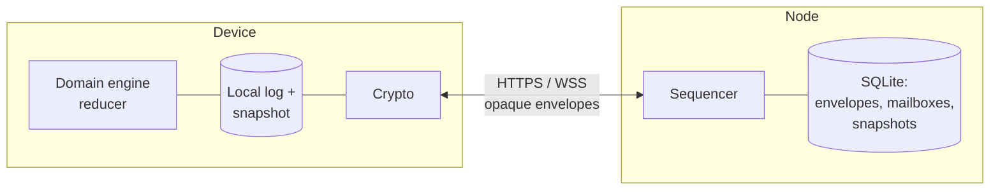
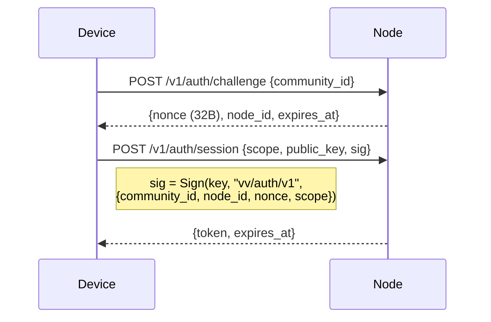
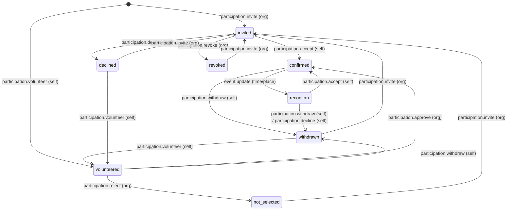

# Protocol Specification — v0 (draft)

> Status: **Phase 0 draft.** Normative for Phase 1–4 implementations. Breaking
> changes are expected until v1. Sections tagged **[MVP]** must be implemented
> for the first usable release; **[LATER]** sections are specified so the MVP
> does not paint itself into a corner, but need not be built yet.
>
> Key words MUST, SHOULD, MAY are used as in RFC 2119.

This document turns [`architecture.md`](architecture.md) into concrete,
implementable rules. Where it deviates from or sharpens the architecture
document, the deviation is called out in a **Design note**.

---

## 0. Overview



- A **community** is a replicated, append-only **log** of **operations**.
- Community **state** is a pure, deterministic function of the log:
  `state = fold(reduce, genesis, log)`.
- The **node** is a *sequencer and mailbox*: it assigns each accepted operation
  a position (`seq`) in the log and stores ciphertext. It cannot read, forge or
  validate domain content.
- **Devices** decrypt, verify signatures, and run the reducer. Every device
  holding the log computes the same state.
- **Snapshots** let devices skip the log prefix and let the node delete it.

Two planes:

| Plane | Readable by node | Used for |
|---|---|---|
| **Control plane** | Yes (headers only) | Things the node must enforce: who may write, who may rotate keys, genesis |
| **Data plane** | No | Everything else: profiles, membership, events, participation |

The control plane is intentionally tiny. Everything not needed for the node
to do access control lives in the data plane.

---

## 1. Conventions

### 1.1 Encoding

- All structures are encoded as **deterministic CBOR** (RFC 8949 §4.2.1,
  "Core Deterministic Encoding"): definite lengths, shortest-form integers,
  map keys sorted bytewise.
- Map keys are short text strings as given in this document.
- Byte strings are CBOR major type 2. In URLs and JSON debug views they are
  rendered as **lowercase hex**.
- Timestamps are integer **milliseconds since Unix epoch, UTC** (`u64`).
  Timestamps produced by devices are *advisory* — never used for ordering or
  conflict resolution (see §8).
- Identifiers that are not hashes (`op_id`, `event_id`, …) are 16 random bytes
  from a CSPRNG.

### 1.2 Domain separation

Every hash, KDF, signature and AEAD use carries a context string. Context
strings are ASCII, prefixed `vv/`, and versioned, e.g. `vv/op-sig/v1`. The
canonical list is in §15. A signature is always computed over:

```
ctx_len (1 byte) || ctx || cbor(signed_struct_without_sig)
```

Hashes used as identifiers or digests (`community_id`, `member_id`,
`mailbox_id`, `entry_hash`, `state_hash`, invite hashes) are
`SHA-256(ctx || data)`, without the length byte. KDF context strings are the
HKDF `info`. HPKE uses `info = ctx || binding fields`.

Inside `SignedOp.body` (the domain payload, §9), identifiers and keys
(`member_id`, `event_id`, `msk`, `mek`, …) are **lowercase hex text** in v0;
everywhere else in this document `bytes(n)` means a CBOR byte string.

### 1.3 Cryptographic suite `VV1`

| Purpose | Primitive |
|---|---|
| Signatures | Ed25519 (RFC 8032), strict verification (reject non-canonical S, small-order A) |
| Key agreement / envelopes | HPKE (RFC 9180) base mode, `DHKEM(X25519, HKDF-SHA256)`, `HKDF-SHA256`, `ChaCha20Poly1305` |
| Symmetric AEAD | XChaCha20-Poly1305, random 24-byte nonce |
| Hash | SHA-256 |
| KDF | HKDF-SHA256 |

Rationale: all available as audited pure implementations in both stacks
(`@noble/*` in TypeScript; `ed25519-dalek`, `x25519-dalek`, `hpke`,
`chacha20poly1305`, `sha2` in Rust), no native modules required in React
Native. The suite identifier is carried in genesis so a future `VV2` can be
introduced per community.

---

## 2. Identities and keys

### 2.1 Key inventory

| Key | Type | Held by | Scope | Visible to node |
|---|---|---|---|---|
| **Community root key** `CRK` | Ed25519 | founding admin(s), offline-capable | per community, long-lived | public half |
| **Member signing key** `MSK` | Ed25519 | member device | per *(person, community)* | only for admins and mailbox auth (see §3) |
| **Member encryption key** `MEK` | X25519 | member device | per *(person, community)* | no |
| **Epoch key** `K_e` | 32-byte symmetric | all members of epoch `e` | per community epoch | no |
| **Epoch access key** `EAK_e` | Ed25519, derived from `K_e` | all members of epoch `e` | per community epoch | public half |
| **Intake key** `IK` | X25519 | admins | per community | public half (in directory entry) |
| **Person root key** `PRK` | Ed25519 | device | global, optional | never |

> **Design note — per-community member keys.** The architecture describes one
> identity per installation. This spec instead has each device generate a
> fresh signing + encryption key pair **per community it joins**. A node
> hosting several communities, or two colluding nodes, therefore cannot link a
> person's memberships by public key. For political organizing this linkage
> is a real risk, and the cost is negligible (one key pair per community).
> The optional `PRK` lets a person *choose* to prove "I am the same person as
> in community X" inside encrypted profile data. This replaces "user_id" in
> the architecture's `Member` record with `member_id` (§2.2).

### 2.2 Derived identifiers

```
community_id = SHA-256("vv/community-id/v1" || CRK.public)    # 32 bytes
member_id    = SHA-256("vv/member-id/v1"    || MSK.public)    # 32 bytes
mailbox_id   = SHA-256("vv/mailbox-id/v1"   || community_id || MSK.public)
```

Human-facing rendering of `community_id`: lowercase RFC 4648 base32, unpadded,
prefixed `vv1`, e.g. `vv1q3f…`. UIs SHOULD show a short fingerprint
(first 8 base32 chars, grouped) for out-of-band verification, never the full ID.

### 2.3 Epoch key derivations

From `K_e` (32 bytes), using HKDF-SHA256 with `salt = community_id || u32be(e)`:

```
op_key_e        = HKDF(K_e, info="vv/op-key/v1")         # AEAD key for data-plane ops
snapshot_key_e  = HKDF(K_e, info="vv/snapshot-key/v1")   # AEAD key for snapshots
EAK_e.seed      = HKDF(K_e, info="vv/epoch-access/v1")   # Ed25519 seed
```

`EAK_e` is the **group credential**: possession of it proves "I am a member of
the current epoch" to the node without telling the node *which* member.

### 2.4 Key storage on devices

- `MSK`, `MEK`, `PRK`, and every `K_e` MUST be stored in the platform secure
  enclave / keystore where available (iOS Keychain with
  `kSecAttrAccessibleAfterFirstUnlockThisDeviceOnly`; Android Keystore-wrapped
  key). Raw key material MUST NOT be written to the SQLite database
  unencrypted.
- `CRK` SHOULD additionally be exportable as a printed recovery sheet
  (BIP-39-style word list over the 32-byte seed) for the founding admin. Loss
  of `CRK` is survivable (see §11.4) but not ideal.

---

## 3. Authentication to the node

The node never sees a password or account. It authenticates **capabilities**:

| Scope | Credential | Grants |
|---|---|---|
| `community` | signature by current `EAK_e` | read/write the community log, read/write snapshots, post to any mailbox in the community |
| `mailbox` | signature by an `MSK` whose `mailbox_id` is addressed | read/ack that one mailbox |
| `control` | signature by an `MSK` in the node's **admin set** | submit control-plane ops |
| `intake` | none (rate-limited), or an invite token | submit join requests |

### 3.1 Handshake [MVP]



- `node_id` is the node's own Ed25519 public key (see §11.1). Binding it into
  the signature prevents a malicious node from relaying a challenge to a
  different node.
- Tokens are opaque, ≥ 128 bits random, TTL ≤ 24 h, bound to scope.
- A device typically holds two tokens per community: `community` (via `EAK_e`)
  and `mailbox` (via its `MSK`). Admins also hold `control`.

> **Design note — what the node learns.** The node learns the public half of
> `EAK_e` (shared by all members — reveals nothing individual), the `MSK`
> public key of each device that checks its mailbox (pseudonymous,
> per-community), and the admin set's public keys. It does not learn member
> names, the member roster, or roles other than admin. This is the concrete
> meaning of "the node is not trusted with plaintext private data".

---

## 4. Operation format

### 4.1 Envelope (what the node stores)

```
OpEnvelope {
  v:       1
  cid:     bytes(32)        # community_id
  op_id:   bytes(16)
  epoch:   u32
  plane:   "d" | "c"        # data | control
  ctrl:    ControlHeader?   # present iff plane == "c"
  nonce:   bytes(24)
  ct:      bytes            # XChaCha20-Poly1305(op_key_epoch, nonce, cbor(SignedOp), aad)
  asig:    bytes(64)        # Sign(EAK_epoch, "vv/op-access/v1", envelope_without_asig)
}
aad = cbor({v, cid, op_id, epoch, plane, ctrl})
```

Node-side checks before accepting (all cheap, none require keys):

1. `cid` is hosted here; `epoch == current_epoch` (or `current_epoch - 1`
   within the grace window, §7.4).
2. `asig` verifies under `EAK_epoch.public`.
3. `op_id` not already present → otherwise return the existing `seq`
   (idempotent, §6.3).
4. For `plane == "c"`: control-plane checks (§5).
5. Size ≤ `max_op_bytes` (default 64 KiB).

### 4.2 Log entry (what the node returns)

```
LogEntry {
  seq:    u64          # assigned by node, starts at 1 (genesis)
  prev:   bytes(32)    # hash of previous LogEntry; genesis: 32 zero bytes
  env:    OpEnvelope
  at:     u64          # node receive time (advisory)
}
entry_hash = SHA-256("vv/log-entry/v1" || cbor({seq, prev, env, at}))
```

`at` is covered by the hash because it drives the retention clock (§12.2):
a node must not be able to show different devices different times for the
same entry.

The `prev` chain lets any device that holds two entries detect a node that
rewrote history (§13).

### 4.3 Signed operation (inside the ciphertext)

```
SignedOp {
  op_id:    bytes(16)   # MUST equal envelope op_id
  cid:      bytes(32)   # MUST equal envelope cid
  epoch:    u32         # MUST equal envelope epoch
  author:   bytes(32)   # MSK.public of the author
  base:     u64         # highest seq the author had applied when creating this op
  ts:       u64         # author clock, advisory
  type:     text        # e.g. "event.create"
  body:     map         # type-specific, §9
  sig:      bytes(64)   # Sign(MSK, "vv/op-sig/v1", SignedOp_without_sig)
}
```

The inner signature binds `op_id`, `cid` and `epoch`, so a member cannot lift
another member's signed op into a different envelope, community or epoch.

> **Design note — sign-then-encrypt.** Author identity is inside the
> ciphertext, so the node cannot tell who wrote what. The node verifies only
> `asig` ("some current member wrote this"); devices verify `sig`
> ("this specific member wrote this").

---

## 5. Control plane [MVP]

Control-plane ops carry a cleartext `ControlHeader` the node enforces, plus an
encrypted `SignedOp` with the human-meaningful details.

```
ControlHeader {
  kind:     "genesis" | "rotate" | "admin.set"
  signer:   bytes(32)      # MSK.public of an admin, or CRK.public for genesis / recovery
  csig:     bytes(64)      # Sign(signer, "vv/ctrl-sig/v1", {cid, op_id, epoch, kind, args})
  args:     map            # kind-specific, below
}
```

| kind | args | Node enforces |
|---|---|---|
| `genesis` | `{suite: "VV1", crk: CRK.public, admins: [MSK.public], eak: EAK_0.public, ik: IK.public}` | `signer == crk`; `SHA-256(ctx‖crk) == cid`; only valid as `seq 1` |
| `rotate` | `{new_epoch: u32, eak: EAK_new.public}` | `signer ∈ admin_set`; `new_epoch == current_epoch + 1` |
| `admin.set` | `{admins: [MSK.public], ik: IK.public?}` | `signer ∈ admin_set` **or** `signer == crk`; set non-empty |

`rotate` and `admin.set` are encrypted under the **old** epoch key (the one
in `epoch`), and the node switches `current_epoch` after accepting a `rotate`.

`admin.set` signed by `CRK` is the **recovery path**: if every admin device is
lost or an admin turns hostile, the holder of `CRK` can reset the admin set.

Devices MUST independently re-verify every control header — the node's
enforcement is a convenience, not a trust anchor.

The inner `SignedOp.type` of a control op is `community.init` (genesis),
`epoch.rotate` or `admin.set`, and its `author` MUST equal `ctrl.signer`.
A control entry's **effect comes from its header alone**, checked with exactly
the rules in the table above: the node cannot read the body, so any extra
device-side condition would let devices and the node disagree about the
current epoch or admin set. A body that is unreadable, or whose type/author
does not match the header, is ignored (outcome `opaque`). Data-plane ops
carrying a control inner type are rejected as `malformed`.

> **Design note — admin set in the clear.** The node must refuse key rotations
> from non-admins, otherwise any member (or a removed member before the
> rotation lands) could seize the epoch. That requires the node to know admin
> public keys. They remain pseudonymous per-community keys. Threshold
> (k-of-n) admin signatures **[LATER]** slot in here by allowing `csig` to be
> a list and adding `threshold` to `admin.set`.

---

## 6. Synchronization [MVP]

### 6.1 Ordering model

The node assigns `seq` in the order it accepts envelopes. **`seq` order is the
canonical order of the log**, and therefore of the reducer.

> **Design note — why a sequencer instead of a CRDT.** The architecture calls
> for "a monotonically increasing logical version" and deterministic domain
> rules (§44). A single-node sequencer gives both with far less complexity
> than a CRDT, and keeps the reducer simple: ops are applied one at a time
> against the current state and are either *valid* (applied) or *rejected*
> (recorded, no effect). The node can delay or withhold ops but cannot forge
> or alter them, and reordering is detectable by the `base` field and
> hash-chain (§13). Multi-node replication **[LATER]** keeps a single
> sequencer per community (the "primary"), with other nodes as replicas and
> failover; it does not need consensus.

### 6.2 Device sync loop

```
loop:
  push:  POST pending local ops (batch, idempotent)
  pull:  GET ops after local_seq
         if 410 Gone → fetch latest snapshot, restore, retry pull
  apply: for each entry in seq order:
           verify prev-chain, asig, decrypt, verify sig, reduce
  mbox:  GET mailbox items, process, ack
  wait:  WebSocket "head" notification, or backoff timer
```

Locally authored ops are applied **optimistically** to a pending overlay
(shown in the UI as "sending…") and re-applied in canonical order once they
come back with a `seq`. If the canonical application rejects them, the UI
shows the rejection reason (§8.3).

### 6.3 Idempotency

- The node keeps `op_id → seq` for every op it has ever accepted, **including
  compacted ones** (16 + 8 bytes per op; 10 M ops ≈ 240 MB worst case — fine
  for SQLite; may be pruned after `op_id_retention`, default 1 year).
- Re-submission of a known `op_id` returns `200 {seq}` with no side effects.
- Devices MUST NOT reuse an `op_id` across different contents. A node that
  receives a known `op_id` with a different envelope hash returns
  `409 Conflict` and logs it.

### 6.4 Resumption

Pull is always `after=<last applied seq>`. There is no session state on the
node beyond the auth token; any interruption resumes from the device's
persisted `local_seq`.

### 6.5 Acknowledgements

- Log entries are not acknowledged (they are shared, retained until compaction).
- Mailbox items are acknowledged per item; acked items are deleted.
- Devices MAY report `PUT /v1/c/{cid}/cursor {seq}` (community scope,
  unauthenticated as to *which* member) so the node and admins can see an
  anonymous histogram of how far behind devices are, which informs compaction.

---

## 7. Epochs and key distribution [MVP]

### 7.1 Key envelope

```
KeyEnvelope {
  cid:       bytes(32)
  epoch:     u32
  recipient: bytes(32)     # recipient MEK.public
  enc:       bytes(32)     # HPKE encapsulated key
  ct:        bytes         # HPKE.Seal(info="vv/key-env/v1"||cid||u32be(epoch),
                           #           aad=cbor({cid, epoch, recipient}), pt=K_epoch)
}
```

Envelopes are delivered via the recipient's **mailbox** (§10), not embedded in
the log — that keeps `rotate` ops O(1) in size regardless of member count.

### 7.2 When to rotate

| Event | Rotate? |
|---|---|
| member removed / leaves | **MUST** |
| admin removed | **MUST** (also issue `admin.set`, and new `IK`) |
| member joins | SHOULD NOT by default; community policy `rotate_on_join` MAY enable it |
| suspected device compromise | MUST |
| scheduled | MAY (policy, e.g. every 90 days) |

### 7.3 Rotation procedure (admin device)

1. Generate `K_{e+1}`; derive `EAK_{e+1}`.
2. Compute the recipient list from **local** state (all active members after
   the change).
3. Submit control op `rotate {new_epoch: e+1, eak}` encrypted under `K_e`;
   its `SignedOp.body` = `{reason, removed: [member_id]}`.
4. On acceptance, post one `KeyEnvelope` per recipient to their mailbox,
   authenticated with `EAK_{e+1}`.
5. Persist `K_{e+1}` locally; begin writing under epoch `e+1`.

Offline members receive their envelope from the mailbox whenever they return,
with no time limit (envelopes for the current epoch are exempt from mailbox
TTL).

### 7.4 Grace window

After a `rotate`, the node continues to accept envelopes under `e` (signed
by `EAK_e`) for `epoch_grace` (default 10 minutes). This lets ops authored
just before the rotation land without a round-trip. Data-plane envelopes
under `e` are never accepted after the grace window; devices re-encrypt ops
still pending under the new epoch and resubmit them with the same `op_id`.
(The node cannot inspect `base`, which is encrypted, so the window is purely
time-based.)

> Removed members can use the grace window too; their late ops are then
> **rejected by the reducer** (author not an active member at that `seq`), so
> the window is an availability feature, not a security hole.

### 7.5 Concurrent rotations

Two admins rotating concurrently both target `e+1`; the node accepts the first
and rejects the second with `409 epoch_conflict`. The losing admin discards
its `K_{e+1}`, syncs, and retries if its reason still applies (e.g. the member
it wanted removed was not removed by the winning rotation).

### 7.6 Access to history

A new member receives only the current `K_e`. They read community state from
the **latest snapshot** (encrypted under the current epoch, §12) rather than by
decrypting history. Older log entries remain unreadable to them — this is a
deliberate privacy property, not a gap.

---

## 8. Reducer semantics and conflict resolution [MVP]

### 8.1 Determinism

`reduce(state, entry) → (state', outcome)` MUST be a pure function of its
inputs: no clocks, randomness, locale, or I/O. Floating point MUST NOT be
used. Iteration over maps MUST be in sorted-key order.

### 8.2 Validation order

For each log entry, a device:

1. checks the `prev` chain;
2. verifies `asig`;
3. if `plane == "c"`, verifies `ControlHeader` against current state (§5);
   for data-plane entries, checks `epoch ∈ {current, current − 1}`
   (`stale_epoch` otherwise);
4. decrypts `ct`; if it lacks `K_epoch`, marks the entry **opaque** and stops
   (it will be covered by a later snapshot). A device that *can* decrypt an
   entry but has no EAK to check its `asig` treats this as an integrity
   failure, not as content: the node may have fabricated it;
5. verifies `SignedOp.sig` and the `op_id/cid/epoch` binding. A failure here
   means a member (who holds `K_epoch` and `EAK_epoch`) produced something
   invalid, e.g. lifted another member's signed op into a new envelope or
   signed as someone else. The entry is treated as **opaque**: it has no
   effect and cannot be attributed to the claimed author;
6. checks **authorization** of `author` at this point in the log (role, status);
7. checks the **state-machine transition** (§9) is legal;
8. applies, or records `rejected(reason)`.

Rejected ops stay in the log and are harmless. Rejection reasons are
enumerated (`not_member`, `not_authorized`, `illegal_transition`,
`capacity_full`, `unknown_target`, `malformed`, …) so the author's UI can say
*"Your acceptance arrived after the event was cancelled."*

### 8.3 Conflict rule

Because every op is evaluated against the state produced by all earlier ops,
the general conflict rule is simply: **first valid op in `seq` order wins;
later ops that are no longer legal are rejected.** Domain state machines are
designed so that this produces sensible outcomes (terminal states are
terminal, cancellations dominate, members can always withdraw themselves).

### 8.4 Unknown op types

Devices MUST treat unknown `type` values as `rejected(unknown_type)` without
error, so newer clients can introduce types without breaking older ones. A
community MAY set `min_client_version` in policy to force upgrades when a new
type affects safety-relevant state.

---

## 9. Domain operations [MVP]

All bodies below are the `SignedOp.body`. "Org" = organizer or admin.
Roles are hierarchical: `admin ⊃ organizer ⊃ member`.

### 9.1 Community and policy

| type | body | who | effect |
|---|---|---|---|
| `community.init` | `{name, description, region?, policy, founders: [{msk, mek, profile}]}` | a founding admin | Encrypted half of genesis; MUST be in `seq 1`. `founders` MUST be exactly the genesis `admins`; they start as active admins. |
| `community.update` | `{name?, description?, region?}` | admin | |
| `policy.update` | `{policy}` | admin | Replaces policy wholesale. |

```
Policy {
  join:                  "invite_only" | "request" | "open_request"   # see §10.3
  rotate_on_join:        bool        = false
  volunteer_mode:        "confirm" | "auto"     = "confirm"
  participation_visible: "community" | "organizers" = "community"
  retention: {
    completed_event_detail_days: u32 = 30    # then reduced to EventSummary
    keep_attendee_list:          bool = false
    removed_member_detail_days:  u32 = 30    # then profile is dropped
    rejected_join_request_days:  u32 = 7
  }
  min_client_version: text?
}
```

### 9.2 Membership

```
MemberRecord {
  member_id, msk: bytes(32), mek: bytes(32),
  role: "member" | "organizer" | "admin",
  status: "active" | "removed" | "left",
  profile: { display_name, contact?, prk_binding? },
  joined_seq: u64, key_epoch: u32
}
```

| type | body | who | legal when |
|---|---|---|---|
| `member.add` | `{msk, mek, profile, role="member", request_id?}` | admin | `msk` not active |
| `member.remove` | `{member_id, reason?}` | admin; organizer may remove `member` role only | target active |
| `member.leave` | `{}` | self | self active |
| `member.role` | `{member_id, role}` | admin | target active; MUST NOT demote the last admin |
| `member.profile` | `{profile}` | self | self active |

`member.add` for an admin role is not allowed directly: add as member, then
`member.role` + control-plane `admin.set`. Devices treat a member as admin only
if **both** the data-plane role is `admin` **and** their `msk` is in the
control-plane admin set; mismatch is surfaced as a warning to admins.

`member.remove`/`member.leave` MUST be followed by a `rotate` (§7.2). Admin
clients do this automatically and atomically from the user's point of view.

When a member is removed or leaves, every open participation (`invited`,
`volunteered`, `confirmed`, `reconfirm`) of theirs in a `scheduled` event
becomes `withdrawn`, and they are dropped from those events' `organizers`.
Closed events keep their history.

Permissions summary: *community organizer* (role organizer or admin) may
create events, invite, revoke, approve and reject. Editing, cancelling,
completing and recording attendance require being in the event's
`organizers` (and still an organizer) or an admin.

### 9.3 Events

```
Event {
  event_id, title, description,
  starts_at, ends_at, tz: text (IANA),
  location: {
    label:   text,               # "Praça do Derby"
    area:    {lat_e4, lng_e4},   # integer degrees × 10⁴ (~11 m); see §9.6
    radius_m: u32?               # fuzzing radius shown to non-confirmed members
  },
  capacity: u32?,
  organizers: [member_id],
  status: "scheduled" | "cancelled" | "completed",
  created_seq
}
```

| type | body | who | legal when |
|---|---|---|---|
| `event.create` | `{event_id, …fields}` | org | `event_id` unused |
| `event.update` | `{event_id, …changed fields}` | event organizer or admin | `scheduled` |
| `event.cancel` | `{event_id, reason?}` | event organizer or admin | `scheduled` |
| `event.complete` | `{event_id}` | event organizer or admin | `scheduled` |
| `event.attendance` | `{event_id, attended: [member_id]}` | event organizer or admin | `completed`; each id has `confirmed` participation |

`event.update` that changes `starts_at`, `ends_at` or `location.area` resets
every `confirmed` participant to `reconfirm` (see §9.4), because availability
was computed against the old values.

### 9.4 Participation

One `Participation` per `(event_id, member_id)`:



Body for every `participation.*`: `{event_id, member_id}` (`member_id` implied
= author for self-actions), plus optional `note`.

Rules:

- All transitions require event `status == scheduled`. When an event is
  cancelled or completed, participation freezes.
- **Capacity:** a transition into `confirmed` when `count(confirmed) ≥
  capacity` is rejected with `capacity_full`. (Waitlists are **[LATER]**.)
- `volunteer_mode == "auto"`: `participation.volunteer` goes straight to
  `confirmed` (subject to capacity).
- **No silent assignment:** no transition puts a member into `confirmed`
  without an op authored by that member (`accept`) or by that member having
  volunteered first (`volunteer` → `approve`).
- `withdraw` is always available to the member while the event is
  `scheduled`. People's lives change; the protocol must not trap them.

Worked conflict examples (first-valid-wins, §8.3):

| Ops in seq order | Result |
|---|---|
| `accept` (phone), `decline` (tablet) | `confirmed`; decline → `illegal_transition` (UI suggests *withdraw*) |
| `event.cancel`, `accept` | event cancelled; accept → `illegal_transition` |
| `invite` (org A), `invite` (org B) | `invited`; second → `illegal_transition` (harmless duplicate) |
| `accept` by X, `accept` by Y, capacity = 1 | X `confirmed`; Y → `capacity_full` |
| `member.remove X`, `accept` by X | X removed; accept → `not_member` |

### 9.5 Participation visibility [LATER-compatible]

With `participation_visible == "organizers"`, `participation.*` ops authored
by members carry `body.sealed` instead of plaintext fields: an HPKE seal of
the body to each event organizer's `MEK`. Non-organizers' reducers see only
"some participation op occurred on event E" and keep a count, not identities.
MVP clients MUST implement `"community"` and MUST reject `"organizers"` in
`policy.update` until supported.

### 9.6 Location precision

`area` is stored at ~11 m precision for organizers. Clients display
non-confirmed members a point **snapped to the centre of a cell of
`radius_m`** (default 500 m), computed locally from `area`. Precise
meeting-point details (address, gate, contact on arrival) go in
`event.details` **[LATER]**: a mailbox delivery to confirmed participants
only, not a log op.

All of a member's own location data (reference points, radius, current GPS)
is device-local and never appears in any op.

---

## 10. Mailboxes [MVP]

A mailbox is a per-member, per-community queue on the node holding opaque items.

```
MailboxItem {
  item_id: bytes(16), to: mailbox_id, kind: text,
  ttl_s: u32, ct: bytes, posted_at: u64
}
```

| kind | sender | content | ttl |
|---|---|---|---|
| `key_env` | admin | `KeyEnvelope` | none while epoch current |
| `join_result` | admin | HPKE to applicant: `{accepted, reason?, K_e envelope?, node addresses, snapshot hint}` | 30 d |
| `probe` | organizer | §10.4 | ≤ 72 h |
| `probe_reply` | member | §10.4 | ≤ 72 h |
| `ping` | any | wake-up for push (§14) | 1 h |

Posting requires `community` scope (any current member). Reading/acking
requires `mailbox` scope for that `mailbox_id`. Items for non-existent
mailboxes are accepted (the node does not know the roster) and expire by TTL.

### 10.1 Join request (intake)

```
JoinRequest (plaintext) {
  cid,                 # binds the request to one community
  msk, mek,            # applicant's fresh per-community keys
  profile,             # what the applicant chooses to share
  message?, invite_code?,
  sig                  # Sign(MSK, "vv/join-req/v1", rest)
}
Stored on node as: HPKE.Seal(IK.public, info="vv/join/v1"||cid, pt=cbor(JoinRequest))
```

The intake key `IK` is a single X25519 key pair whose private half is shared
among admins (delivered as an HPKE envelope to each admin's `MEK` via the
`admin.set` flow). Applicants seal once to `IK.public`.

> **Design note — intake key vs. per-admin envelopes.** The architecture
> sketches one envelope per admin. A shared intake key keeps the public
> directory entry from revealing how many admins exist or their keys, and
> keeps join requests small. `IK` rotates whenever the admin set shrinks.

The applicant's device also creates its mailbox and polls it for
`join_result` using its fresh `MSK` (mailbox scope does not require
membership).

### 10.2 Approval

Admin device decrypts the request, shows it, and on approval:

1. `member.add {msk, mek, profile, request_id}` (data plane);
2. mailbox `join_result` to the applicant including a `KeyEnvelope` for the
   current epoch;
3. intake item deleted.

Rejection: `join_result {accepted: false}`; intake item deleted. No log op is
written for rejections — the community state never learns about rejected
applicants beyond the retention window.

### 10.3 Invite links

`join == "invite_only"` requires an invite code; `"request"` accepts any
request but the node rate-limits intake; `"open_request"` is `"request"` with
the community listed in directories.

Invite link (QR-encodable):

```
vamovirar://join?c=<community_id>&n=<node_url>&k=<IK.public>&i=<invite_secret>
```

The admin registers `SHA-256("vv/invite/v1" || invite_secret)` with the node
(control scope) with an expiry and max uses. The node checks the hash on
intake. The link alone grants *the right to ask*, never membership.

### 10.4 Availability probes ("find suitable people")

1. Organizer posts `probe` items to members' mailboxes:
   `HPKE.Seal(member MEK, {probe_id, event_id, reply_to: organizer MEK, expires})`.
   Sending to all active members is fine; the node sees N similar-sized items.
2. Each member device evaluates locally (calendar, location, preferences).
3. Device replies with `probe_reply {probe_id, answer: "eligible" | "not_eligible" | "maybe"}`
   sealed to the organizer — **only if** the member's settings allow automatic
   replies; otherwise it notifies the user and replies once they choose.
4. No calendar data, times, or locations are ever in a reply.

Members MAY set "never answer probes"; organizers then see "no answer", which
is indistinguishable from offline.

---

## 11. Nodes, discovery and recovery

### 11.1 Node identity

Each node has its own Ed25519 key `NK`, generated at first start, published at
`GET /.well-known/vamo-virar`:

```
{ protocol: "vv/0", node_id: NK.public, communities: [cid]?, limits: {...} }
```

`communities` is omitted unless the operator opts in to listing.

### 11.2 Directory entry [MVP minimal]

```
DirectoryEntry {
  cid, name, description, region?, join, ik: IK.public,
  nodes: [url], updated_at,
  sig: Sign(CRK or admin MSK, "vv/directory/v1", rest)
}
```

Served by the node at `GET /v1/c/{cid}/directory`. Any third-party directory
is just a cache of signed entries; clients verify the signature against
`community_id` (CRK) or the current admin set. MVP discovery is invite links
plus this endpoint; a shared public directory is **[LATER]**.

### 11.3 Migrating / replacing a node [MVP]

An admin device holds: the latest snapshot it produced or verified, the log
entries after it, and the control-plane chain (genesis + every `rotate` and
`admin.set` entry, which are never compacted — §12.3).

```
POST /v1/c/{cid}/restore   (new node, control scope via genesis CRK or admin chain)
  { control_chain: [LogEntry], snapshot: SnapshotEnvelope, tail: [LogEntry] }
```

The new node verifies: genesis matches `cid`; each control entry is properly
signed by the then-admin-set; `tail` hash-chains from `snapshot.head`. It then
continues the same `seq` numbering. The admin publishes a new
`DirectoryEntry` with the new node URL and posts it in-band so devices learn
the address (devices also accept a `node_moved` hint in a final signed op on
the old node if it is still alive).

Mailbox contents are not migrated (they are ephemeral). Admins re-post current
`key_env` items for all members on the new node as part of the restore flow.

### 11.4 Loss scenarios

| Lost | Recovery |
|---|---|
| Node | §11.3 from any admin device. Members' devices can supply missing tail entries. |
| One admin device | Other admin issues `admin.set` without it + `rotate`. |
| All admin devices, CRK safe | CRK holder issues `admin.set` from a new device. |
| CRK, admins safe | Community continues; CRK-only actions (recovery) unavailable. **[LATER]**: `crk.replace` signed by k-of-n admins. |
| Everything | Community must be recreated. Members' local data remains readable on their devices. |

---

## 12. Snapshots and compaction [MVP]

### 12.1 Snapshot format

```
SnapshotEnvelope {
  cid, seq: u64, head: bytes(32),     # entry_hash of log entry `seq`
  epoch: u32, nonce: bytes(24),
  ct: bytes,                          # AEAD(snapshot_key_epoch, nonce, cbor(SignedSnapshot),
                                      #      aad = cbor({cid, seq, head, epoch}))
  asig: bytes(64)                     # Sign(EAK_epoch, "vv/snapshot-access/v1", envelope_without_asig)
}
SignedSnapshot {
  cid, seq, head, epoch,
  state: CommunityState,              # §12.2
  state_hash: bytes(32),              # SHA-256("vv/state/v1" || cbor(state))
  author: MSK.public,                 # MUST be admin at `seq`
  sig                                 # Sign(MSK, "vv/snapshot-sig/v1", rest)
}
```

### 12.2 CommunityState

Exactly the reducer's state, canonicalized:

```
CommunityState {
  community: {crk, name, description, region, policy},
  epoch, eak, admin_set, ik,
  clock: {seq, now},                       # last applied seq; retention clock
  members: [MemberRecord],                 # active + recently removed (for reason display)
  events: [Event + participations],        # scheduled, and completed within detail window
  event_summaries: [EventSummary],         # completed beyond detail window, per retention
  rejected_recent: [(seq, op_id, author, type, reason)]   # last 100, for author feedback
}
EventSummary { event_id, title, starts_at, status, confirmed_count, attended_count, attendees? }
```

Retention (event detail → `EventSummary`, dropping removed members'
profiles) runs **inside the reducer**, after every entry. It is driven by a
retention clock `now = max(now, entry.at)`, the monotonic maximum of the
node's receive times. Consequences:

- A snapshot is exactly `fold(log[1..S])` (minus the device-local `op_id`
  index), so restoring a snapshot and replaying the tail gives the same state
  as replaying the whole log, and every producer gets the same `state_hash`.
- Author timestamps (`SignedOp.ts`) are never used, so a member cannot force
  early compaction by back- or forward-dating an op. The node could, by
  lying about `at`; it can already withhold ops, so this adds no new power.
- An event is summarized `completed_event_detail_days` after it was
  cancelled or completed (by the retention clock); ops on it after that are
  `unknown_target`, and its `event_id` cannot be reused.

> **Design note.** An earlier draft applied retention only at snapshot
> generation. That makes devices that replay the full log diverge from
> devices that restored a snapshot (e.g. an `event.attendance` on an event
> one of them has already summarized). Found while writing Phase 1.

### 12.3 Who produces snapshots, and when

- Admin devices produce a snapshot when `head − last_snapshot.seq ≥ 500`, or
  after any `rotate` (so new-epoch members can read state), checked during
  sync. Snapshots under the newest epoch supersede older ones.
- Non-admin devices verify the snapshot against their own fold when they have
  the log; a mismatch is reported to admins (`state_hash` mismatch = bug or
  attack).
- The node keeps the latest 2 snapshots.

### 12.4 Log compaction (node side)

After a snapshot at `S` has existed for `compaction_grace` (default 30 days),
the node MAY delete data-plane log entries with `seq ≤ S`. It MUST keep:
control-plane entries (forever; they are tiny), the `op_id → seq` index
(§6.3), and the `entry_hash` of entry `S`.

A device asking for `after=k` with `k < oldest retained seq` gets
`410 Gone {snapshot_seq}` and restores from the snapshot.

> **Design note.** This implements "the operation log is a synchronization
> mechanism; the snapshot is the durable representation" (architecture §56).
> The 30-day grace means ordinary offline periods (a week, a month) are
> handled by log replay, which preserves rejection feedback for the user's
> own ops; longer absences fall back to snapshots.

### 12.5 Device-side retention

Devices apply the same retention policy to their local stores. A device MAY
keep more history locally for its own member (e.g. "events I attended"),
which never leaves the device.

---

## 13. Integrity against a misbehaving node

The node can **withhold**, **delay**, **reorder before sequencing**, or
**fork** (show different logs to different devices). It cannot forge,
alter, or read ops.

Mitigations in v0:

- `prev` hash chain: a device never accepts a log entry that does not chain
  from its last applied entry.
- `base` field: a device that sees its own op sequenced long after many
  entries it never saw can flag suspicious withholding.
- Snapshots carry `head`; devices compare `(seq, head)` pairs with other
  members' snapshots and, **[LATER]**, via peer gossip (QR code or P2P) to
  detect forks.
- Restore (§11.3) means a node that misbehaves can be replaced without
  losing the community.

---

## 14. Push notifications [MVP, open issue]

APNs and FCM require credentials belonging to the **app publisher**, so a
self-hosted node cannot push to the official app directly.

v0 design:

- The project runs a stateless **push gateway** (open source, self-hostable
  for forks of the app). It holds the APNs/FCM credentials and nothing else.
- A device registers with its node: `PUT /v1/c/{cid}/push {mailbox_id, gateway, token_ct}`
  where `token_ct` is the platform token sealed to the gateway's public key,
  so the node never sees the raw token.
- When a mailbox item or new log head arrives, the node POSTs
  `{token_ct}` to the gateway; the gateway sends a **content-free** push
  ("You have new activity" or a silent background wake).
- The gateway learns that *some* device got *a* notification, not from which
  community.
- Android builds without Google Play Services MAY use UnifiedPush instead.

This is the one piece of shared infrastructure the system needs; it MUST stay
optional (the app works, with polling, without it) and contain no state.

---

## 15. Node HTTP API [MVP]

Base: `https://<node>/v1`. Request and response bodies are deterministic
CBOR (`application/cbor`); `.well-known` is JSON. Identifiers in paths
(`{cid}`, `{mbx}`) are **lowercase hex**. Authenticated calls send
`Authorization: Bearer <token>` from §3.1.

| Method & path | Scope | Request → response |
|---|---|---|
| `GET /.well-known/vamo-virar` | — | → JSON `{protocol, node_id, api, limits}` |
| `POST /auth/challenge` | — | `{community_id}` → `{nonce, node_id, expires_at}` (single use, 60 s) |
| `POST /auth/session` | — | `{community_id, nonce, scope, public_key, sig}` → `{token, expires_at}` |
| `POST /communities` | provisioning token (`x-vv-provision-token`) | `{genesis: OpEnvelope}` → `{community_id, seq}` |
| `POST /communities/restore` | provisioning token | `{control_chain: [LogEntry], snapshot?, tail: [LogEntry]}` → `{community_id, head_seq}` (§11.3) |
| `POST /c/{cid}/ops` | community | `{ops: [OpEnvelope]}` (≤ 100) → `{results: [{op_id, seq} \| {op_id, error}], head_seq}` |
| `GET /c/{cid}/ops?after=&limit=` | community | → `{entries: [LogEntry], head_seq}` or `410 {code: "gone", snapshot_seq}` |
| `GET /c/{cid}/control` | community | → `{entries}`: every control-plane entry (never compacted) |
| `GET /c/{cid}/snapshot` | community | → latest `SnapshotEnvelope` |
| `PUT /c/{cid}/snapshot` | **control** | `SnapshotEnvelope` → `{seq}`; `head` must equal the hash of entry `seq` |
| `POST /c/{cid}/mailbox/{mbx}` | community | `{kind, ct, ttl_s?}` → `{id}`; `key_env` items never expire |
| `GET /c/{cid}/mailbox/{mbx}?after=` | mailbox (own `mbx` only) | → `{items: [{id, kind, ct, posted_at}]}` |
| `DELETE /c/{cid}/mailbox/{mbx}/{id}` | mailbox | ack |
| `POST /c/{cid}/intake` | — (rate-limited) | `{enc, ct, invite?}` → `{id}`; `invite` is the raw secret, checked against registered hashes in `invite_only` mode |
| `GET /c/{cid}/intake?after=` / `DELETE …/{id}` | control | admins read/ack sealed join requests |
| `PUT /c/{cid}/intake-policy` | control | `{mode: "open" \| "invite_only" \| "closed"}` |
| `POST /c/{cid}/invites` | control | `{hash, expires_at, max_uses}` |
| `GET /c/{cid}/directory` / `PUT` | — / control | opaque signed `DirectoryEntry` (§11.2) |
| `PUT /c/{cid}/cursor` | community | §6.5 **[LATER]** |
| `PUT /c/{cid}/push` | mailbox | §14 **[LATER]** |
| `GET /c/{cid}/stream?token=&mailbox_token=` (WebSocket) | community (+ mailbox) | server → client CBOR: `{head_seq}`, `{mailbox}`, `{resync: true}` |

The WebSocket carries **notifications only**; data is always fetched over the
idempotent HTTP endpoints, so a dropped socket never loses data.

Tokens are re-validated on every request: a `community` token stops working
when its EAK is no longer current (after the grace window), a `control`
token when its key leaves the admin set.

> **Design note — snapshot upload is admin-only.** Uploading a snapshot lets
> the node compact the log behind it after `compaction_grace`. If any member
> holding the EAK could upload one, a malicious member could plant a junk
> snapshot and, a month later, leave new members with nothing usable. Found
> while implementing Phase 3.

Errors: `{code: text, detail: text}` with codes `malformed`, `unauthorized`,
`forbidden`, `not_hosted`, `not_found`, `epoch_stale`, `epoch_conflict`
(a `rotate` that lost a race, §7.5), `op_conflict`, `already_exists`,
`gone`, `stale`, `too_large`, `rate_limited`, `closed`.

### Context strings

```
vv/community-id/v1   vv/member-id/v1   vv/mailbox-id/v1
vv/op-key/v1         vv/snapshot-key/v1  vv/epoch-access/v1
vv/auth/v1           vv/op-access/v1   vv/op-sig/v1
vv/ctrl-sig/v1       vv/log-entry/v1   vv/key-env/v1
vv/join/v1           vv/join-req/v1    vv/invite/v1
vv/state/v1          vv/directory/v1   vv/snapshot-sig/v1
vv/snapshot-access/v1
```

---

## 16. Versioning

- Envelope `v` and `/v1` path version are bumped only for wire-incompatible
  changes.
- New op types are additive (§8.4).
- `protocol` in `.well-known` lets clients refuse incompatible nodes with a
  clear message.

---

## 17. Open questions

These need decisions before or during Phase 1–2. Each lists the current
default.

1. **Multiple devices per person.** Default: one device per membership; moving
   phones uses an encrypted device-to-device transfer (QR). Linked devices
   sharing a membership are **[LATER]**.
2. **Lost phone, no backup.** Default: the person re-joins as a new member; an
   admin can mark the old `member_id` as `removed` and the new one with the
   same profile. An optional encrypted backup (passphrase-derived key,
   Argon2id) of the per-community keys to the user's own cloud drive is a
   candidate for MVP given the target audience.
3. **Participation visibility default.** Default `"community"` for MVP
   simplicity; for some communities `"organizers"` may be the safer default.
   Needs input from real organizers.
4. **Event content visibility.** Today all members see all events. Sub-groups
   (e.g. "coordination team" events) would need per-group keys **[LATER]**.
5. **Snapshot author trust.** A malicious admin can produce a false snapshot;
   members holding the log detect it, new members cannot. Acceptable for v0
   (admins are already highly trusted), revisit with threshold admins.
6. **Push gateway operation.** Who runs the default gateway, and its
   privacy policy.
7. **Abuse of intake.** Rate limiting per IP may be too weak for public
   communities under harassment; consider proof-of-work or invite-only by
   default.
8. **Legal/data-protection.** LGPD applicability to node operators who only
   hold ciphertext and pseudonymous keys.

---

## 18. Conformance tests (to be built in Phase 1–4)

Each MUST be a shared test vector consumed by both the TypeScript and Rust
implementations (`tests/vectors/vv1.json`, generated by `packages/crypto/test/vectors.test.ts`):

- Encoding: deterministic CBOR round-trips; signature byte-exactness.
- Key derivations from fixed `K_e`, `community_id`.
- Reducer: every transition in §9.4 legal and illegal; each conflict example
  in the table; capacity; last-admin protection.
- Determinism: random permutations of *submission* order → identical state
  given identical `seq` assignment; duplicate `op_id` → no change.
- Epoch: removed member cannot decrypt ops or snapshot after `rotate`;
  late op from removed member in grace window → `not_member`.
- Compaction: `410` path; snapshot `state_hash` identical across producers.
- Restore: rebuilt node serves an identical `(seq, head)` to the original.
